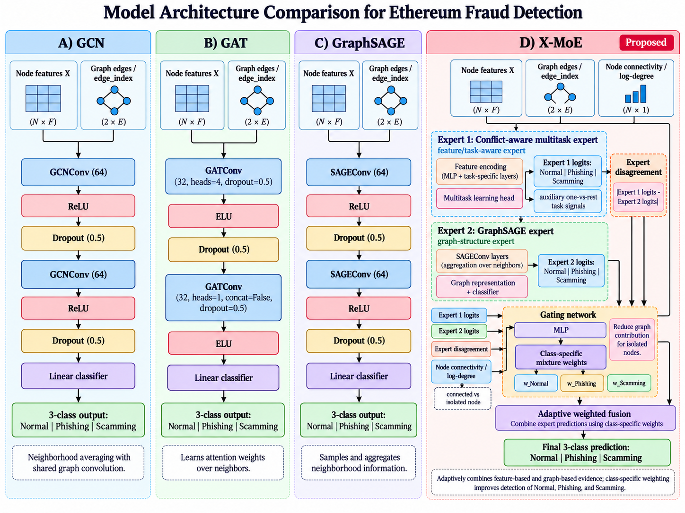

# X-MoE for Multi-Class Ethereum Fraud Detection

This repository provides the manuscript-aligned implementation and result summaries for three-class Ethereum address classification under severe class imbalance and sparse graph connectivity.

Classes:
- Normal
- Phishing
- Scamming

The manuscript compares five models under the main clean protocol:
- MLP — feature-only baseline
- GCN
- GAT
- GraphSAGE
- X-MoE — proposed task-aware mixture-of-experts framework

## Repository structure

```text
src/
├── models/
│   ├── __init__.py      # exports the model classes; not an experiment runner
│   ├── gcn.py
│   ├── gat.py
│   ├── graphsage.py
│   ├── mlp.py
│   └── xmoe.py
└── reproduce.py         # main clean/artifact reproduction runner

experiments/
├── ablation.py          # A0–A7 ablation + connectivity-stratified analysis
└── strict_inductive.py  # STRICT-INDUCTIVE evaluation

results/
├── paper/               # manuscript-facing result summaries
├── reference/           # reference CPU/GPU/statistical tables
└── lambda_sensitivity/  # Normal–Phishing coefficient sensitivity summary
```

`src/models/__init__.py` only exposes model classes to Python. Training and evaluation are performed by the runners above.

## Dataset and task

The study uses processed BLTE artifacts released by the upstream project. The repository does not independently reconstruct the raw Ethereum collection or labelling pipeline.

Dataset size:
- 73,033 Ethereum addresses
- 72,865 Normal
- 69 Phishing
- 99 Scamming
- 23 node features
- 6,588 released directed edges
- approximately 92.32% isolated nodes

Required local files:

```text
upstream-paper/BLTE_multiclass_graph.pt
upstream-paper/BLTE_multiclass_v2.csv
```

Expected SHA-256 hashes:

```text
BLTE_multiclass_graph.pt
2859A8A3A815EDD02B5CD85D46C00D730B2B66C4E8D047145DB2E843C9E38456

BLTE_multiclass_v2.csv
02E376DDD98BA595372F19731FE5E51BBC90BF897B2A52B3C8BB98E786423B11
```

## Main clean protocol

All main manuscript results use:
- stratified 70/15/15 train/validation/test splits regenerated for every seed;
- seeds 100–109;
- 300 epochs;
- train-only feature standardisation;
- deterministic execution;
- released BLTE topology retained across node partitions;
- checkpoint selection by highest validation Macro-F1.

This protocol is described as topology-visible because the released graph topology is retained. It should not be interpreted as a strict node-inductive evaluation.

## Main results

| Model | Accuracy (mean ± std) | Macro-F1 (mean ± std) |
|---|---:|---:|
| GCN | 0.8811 ± 0.0329 | 0.3637 ± 0.0205 |
| GAT | 0.5917 ± 0.0336 | 0.2665 ± 0.0171 |
| MLP | 0.9672 ± 0.0081 | 0.3715 ± 0.0085 |
| GraphSAGE | 0.9882 ± 0.0021 | 0.4916 ± 0.0336 |
| **X-MoE** | **0.9969 ± 0.0012** | **0.6575 ± 0.0712** |

Relative to GraphSAGE, X-MoE improves mean Macro-F1 by 0.1659, equivalent to approximately 33.74% relative improvement.

### Class-specific F1

| Model | Normal F1 | Phishing F1 | Scamming F1 |
|---|---:|---:|---:|
| GCN | 0.9367 | 0.0132 | 0.1412 |
| GAT | 0.7430 | 0.0036 | 0.0528 |
| MLP | 0.9837 | 0.0434 | 0.0874 |
| GraphSAGE | 0.9944 | 0.1023 | 0.3782 |
| **X-MoE** | **0.9988** | **0.5374** | **0.4363** |

The largest class-specific improvement is observed for Phishing.

## Paired clean-protocol statistics

The manuscript uses paired seed-level Macro-F1, two-sided exact Wilcoxon signed-rank tests, Holm correction across the four baseline comparisons, paired effect size d_z, and paired mean-difference confidence intervals.

| Comparison | Δ Macro-F1 | 95% CI | Holm-adjusted p | d_z | X-MoE wins |
|---|---:|---:|---:|---:|---:|
| X-MoE vs GCN | 0.2938 | [0.2450, 0.3426] | 0.007812 | 4.309 | 10/10 |
| X-MoE vs GAT | 0.3910 | [0.3382, 0.4438] | 0.007812 | 5.299 | 10/10 |
| X-MoE vs MLP | 0.2860 | [0.2387, 0.3333] | 0.007812 | 4.323 | 10/10 |
| X-MoE vs GraphSAGE | 0.1659 | [0.1216, 0.2101] | 0.007812 | 2.681 | 10/10 |

## X-MoE architecture

X-MoE combines:
1. a Conflict-Aware Multitask Expert containing a feature branch and an internal GraphSAGE branch; and
2. an independently parameterised GraphSAGE Expert.

The framework uses class-specific inner feature–graph routing, class-specific outer expert fusion, disagreement and degree signals, isolate-safe routing, weighted multi-class supervision, three one-versus-rest objectives, a Scamming-specialist objective, a Normal–Phishing objective, and PCGrad.

The reference Normal–Phishing coefficient is λ_NP = 0.30.



Routing weights are reported as model diagnostics, not as causal explanations.

## Ablation study

| Variant | Mean Macro-F1 | Δ vs A0 |
|---|---:|---:|
| A0 Full X-MoE | 0.6575 | — |
| A1 Conflict-Aware only | 0.6525 | -0.0050 |
| A2 GraphSAGE-expert configuration | 0.6558 | -0.0017 |
| A3 Shared routing | 0.6917 | +0.0342 |
| A4 No isolate masking | 0.7071 | +0.0496 |
| A5 No Scamming specialist | 0.6557 | -0.0018 |
| A6 No Normal–Phishing objective | 0.5526 | -0.1049 |
| A7 Fixed 50:50 outer mixture | 0.6912 | +0.0337 |

A0 is the reference architecture, not the numerically best ablation. Only A6 shows a family-wise significant overall degradation after Holm correction.

## Connectivity-stratified analysis

Removing isolate masking improves connected-node discrimination but introduces a small false-positive cost among isolated Normal addresses.

| Metric | Full X-MoE | No isolate masking |
|---|---:|---:|
| Connected-node Macro-F1 | 0.6524 | 0.7273 |
| Connected Phishing F1 | 0.5374 | 0.5576 |
| Connected Scamming F1 | 0.4363 | 0.6301 |
| Isolated Normal FPR | 0.000000 | 0.000307 |

All fraud test nodes in this analysis are connected; the isolated test subset contains only Normal nodes. The result is therefore interpreted as a performance–safety trade-off rather than simple superiority of either configuration.

## STRICT-INDUCTIVE evaluation

`experiments/strict_inductive.py` implements the stricter node-inductive sensitivity protocol. The short display label used in the repository and manuscript is **STRICT-INDUCTIVE**; the code protocol key is `strict_inductive`.

Validation uses train and validation features while excluding validation–validation edges and all test nodes/edges. Test uses train and test features while excluding test–test edges and all validation nodes/edges. The released edge direction is preserved and no reverse edges are synthesised.

| Model | STRICT-INDUCTIVE Macro-F1 |
|---|---:|
| GCN | 0.3583 ± 0.0206 |
| GAT | 0.2771 ± 0.0236 |
| GraphSAGE | 0.4401 ± 0.0204 |
| **X-MoE** | **0.5478 ± 0.0582** |

X-MoE exceeds GraphSAGE in all ten matched seeds under this protocol. This is a sensitivity analysis of topology visibility; it is not evidence of temporal, cross-chain, or cross-dataset generalisation.

## λ_NP sensitivity

| λ_NP | Macro-F1 | Phishing F1 | Scamming F1 |
|---:|---:|---:|---:|
| 0.00 | 0.5526 ± 0.0451 | 0.2379 ± 0.0766 | 0.4226 ± 0.1082 |
| 0.10 | 0.6489 ± 0.0662 | 0.5438 ± 0.1363 | 0.4044 ± 0.1007 |
| **0.30** | 0.6575 ± 0.0712 | 0.5374 ± 0.1433 | **0.4363 ± 0.1010** |
| 0.50 | **0.6580 ± 0.0746** | **0.5551 ± 0.1647** | 0.4203 ± 0.1174 |
| 1.00 | 0.6523 ± 0.0776 | 0.5402 ± 0.1569 | 0.4180 ± 0.1255 |

The main sensitivity occurs when the objective is removed. Values from 0.10 to 1.00 form a broad high-performing region, so λ_NP = 0.30 is retained as the reference setting rather than claimed as a unique optimum.

Machine-readable sensitivity summary:

```text
results/lambda_sensitivity/summary.csv
```

## Reproduction commands

Check model choices:

```powershell
python .\src\reproduce.py --help
```

Expected choices:

```text
{gcn,gat,graphsage,mlp,x_moe_gnn}
```

Example MLP run:

```powershell
python .\src\reproduce.py `
  --model mlp `
  --protocol clean `
  --seeds 100,101,102,103,104,105,106,107,108,109 `
  --epochs 300 `
  --device cpu `
  --deterministic `
  --upstream .\upstream-paper `
  --output-dir .\results\mlp
```

Example X-MoE run:

```powershell
python .\src\reproduce.py `
  --model x_moe_gnn `
  --protocol clean `
  --seeds 100,101,102,103,104,105,106,107,108,109 `
  --epochs 300 `
  --device cpu `
  --deterministic `
  --upstream .\upstream-paper `
  --x-moe-normal-phishing-penalty 0.30 `
  --output-dir .\results\xmoe
```

Ablation:

```powershell
python .\experiments\ablation.py --help
```

STRICT-INDUCTIVE:

```powershell
python .\experiments\strict_inductive.py --help
```

## Verified CPU environment

- Python 3.11.9
- pip 24.0
- PyTorch 2.14.1+cpu
- PyTorch Geometric 2.8.0.post1
- NumPy 2.4.6
- Pandas 3.0.6
- scikit-learn 1.9.1
- SciPy 1.17.1

Install the verified CPU dependencies with:

```powershell
python -m pip install -r .\requirements-cpu-tested.txt
```

## Reproducibility resources

- `REPRODUCIBILITY.md`
- `REPRODUCTION_METADATA_CPU.txt`
- `REPRODUCTION_METADATA_GPU.txt`
- `requirements-cpu-tested.txt`
- `requirements-gpu-tested.txt`
- `results/paper/`
- `results/reference/`
- `results/lambda_sensitivity/`

## Live research demo

https://xmoe-ethereum-fraud-detection.streamlit.app/

The demo is for research communication and model exploration. Quantitative claims in the manuscript are based on controlled multi-seed experiments rather than individual demo predictions.

## License and attribution

Source code is released under the MIT License. The BLTE dataset is not redistributed; ownership, licensing, attribution requirements, and upstream processing decisions remain with the original providers.
