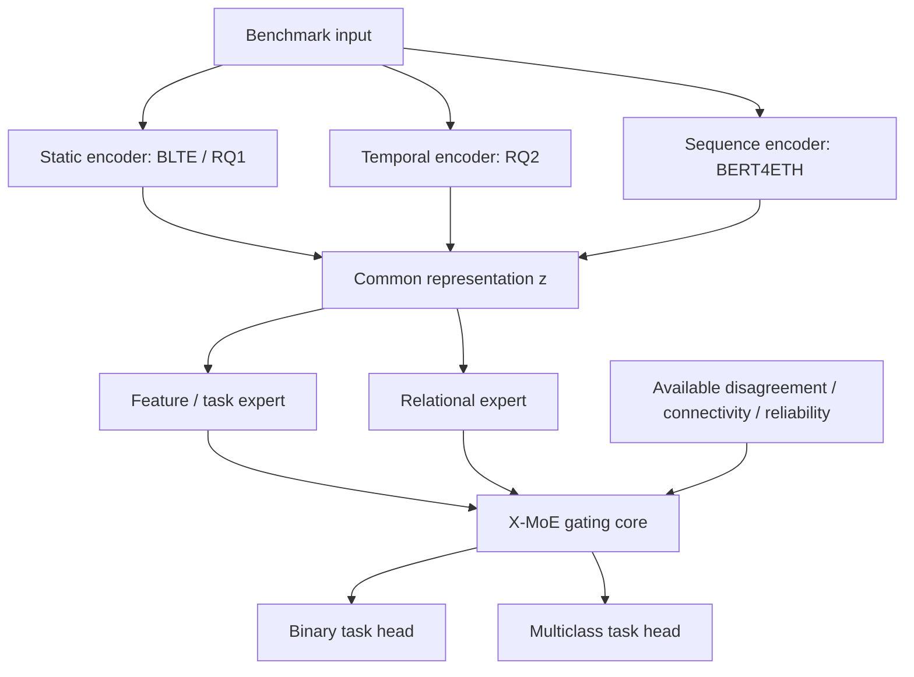

# X-MoE: Ethereum Fraud Detection Across Benchmarks

X-MoE investigates how feature/task evidence and relational evidence can be combined for Ethereum fraud classification. The project currently has static-address benchmark evidence and is being prepared for temporal and sequence benchmarks. This main branch is the general entry point; detailed scientific workflows are separated into reproduction and benchmark.

## 1. Read the project status first

| Workstream | Current status | Where to read |
|---|---|---|
| BLTE source-study reproduction | Completed archived evidence; original public-wrapper caveats retained | reproduction, BLTE section |
| Sweeper source-study reproduction | In progress according to the project owner | reproduction/sweeper |
| BERT4ETH source-study reproduction | Successful run reported by owner; code/results import pending | reproduction/bert4eth |
| BLTE main-study benchmark evaluation | Clean, strict, component ablation, sensitivity and historical CPU/GPU evidence available | benchmark, Part I |
| Matched BLTE + RQ1 CPU study | 100 clean runs complete; verification runs separately attributed | benchmark/studies/matched_two_dataset_cpu |
| Sweeper/RQ1 extended GPU benchmark | 230 full runs complete and audited | benchmark, Part II |
| Temporal/sequence X-MoE extensions | Planned/in development; no completion inferred from architecture | Benchmark roadmap below |

**Source-study reproduction and benchmark evaluation are different evidence scopes.** Completing 230 RQ1 benchmark runs does not establish that Sweeper's source experiment has been reproduced. Successful BERT4ETH reproduction does not establish that its encoder has already been integrated into X-MoE.

## 2. Choose one of three branches

| Branch | Purpose | Detailed README |
|---|---|---|
| main | General project overview, status, stable model reference and navigation | This file |
| reproduction | Source-study reproduction organized by BLTE, Sweeper and BERT4ETH | [Complete reproduction guide](https://github.com/nurhalizaabdulwahab197/xmoe-ethereum-fraud-detection/blob/reproduction/README.md) |
| benchmark | X-MoE/baseline evaluation, dataset adapters, clean/strict/A0–A7/sensitivity and multi-benchmark development | [Complete benchmark guide](https://github.com/nurhalizaabdulwahab197/xmoe-ethereum-fraud-detection/blob/benchmark/README.md) |

The benchmark README retains the full detailed BLTE and Sweeper instructions: setup, input hashes, smoke tests, every full command, monitoring, output checks, tables and limitations. The reproduction README retains the full existing BLTE reconstruction guide, plus explicit Sweeper and BERT4ETH status scaffolds. Instructions were moved by purpose, not discarded or replaced by a short summary.

[Branch organization](docs/BRANCH_GUIDE.md) • [Preserved original references](docs/BRANCH_MIGRATION.json).

## 3. Understand the current X-MoE model

The implemented static model combines a conflict-aware multitask expert with a GraphSAGE expert, using connectivity-aware class-specific routing and isolate-safe handling. The model includes the documented expert objectives and class-focused losses. Baselines include MLP, GCN, GAT and GraphSAGE.

The stable static model modules are retained in src/models on this branch for reference. Dataset-specific training runners and frozen result evidence live on benchmark; source-study implementations live on reproduction. Do not infer an installed unified multi-benchmark package from the presence of model modules alone.

## 4. Intended multi-benchmark architecture

This is a design direction. The static benchmark evidence is available; the common encoder interface, temporal/sequence integration and general reliability inputs still require implementation and validation.



Common representation means a documented interface and output dimensionality. It does not automatically mean joint training, pooled datasets or shared learned weights. Task/label definitions must be verified benchmark by benchmark; binary versus multiclass routing in this diagram is a planned interface, not a claim that every source task is already verified.

Reliability inputs are used only when meaningful and available. Do not fabricate temporal, sequence or connectivity signals for a benchmark that lacks them.

## 5. Know which dataset/protocol you are reading

| Benchmark label | Current evidence scope | Main limitation |
|---|---|---|
| BLTE | 73,033 addresses, 23 released features, sparse released topology | Severe class imbalance and label-correlated released graph construction |
| Sweeper/RQ1 | Prepared cohort-incident graph: 1,322,252 nodes, 4,913 labelled accounts, five observed-graph features | Not full blockchain history; fixed-snapshot features retained in strict analyses |
| RQ2 | Temporal workstream | Adapter/task/evidence must be finalized; no result imported here |
| BERT4ETH | Sequence reproduction reported successful by owner | Successful artifacts have not yet been imported; X-MoE extension remains separate |

RQ1 is the internal identifier retained in the prepared Sweeper code. It must not be confused with the separate window5/session graph artifact. Features and labels are not assumed interchangeable across benchmarks.

## 6. Decide whether you need reproduction or benchmarking

Use reproduction when the question is: can the source study/reference implementation be executed under its documented settings, and what deviations are unavoidable?

Use benchmark when the question is: how do X-MoE and baselines perform under an explicitly defined protocol, and which components/visibility conditions affect the results?

Both require exact input provenance, recorded environments, split rules, checkpoint selection, seeds and saved evidence. A successful workflow rerun is not an independent new dataset or a new source-paper claim.

## 7. Clone main to browse the project

```bash
git clone --branch main --single-branch https://github.com/nurhalizaabdulwahab197/xmoe-ethereum-fraud-detection.git xmoe-overview
cd xmoe-overview
git rev-parse HEAD
```

These commands also work in PowerShell as separate lines. No training starts. Main intentionally does not contain the complete dataset-specific experiment trees; select one of the next workflows for execution.

## 8. Start a source-study reproduction checkout

```bash
git clone --branch reproduction --single-branch https://github.com/nurhalizaabdulwahab197/xmoe-ethereum-fraud-detection.git xmoe-reproduction
cd xmoe-reproduction
```

Then:

1. Read the reproduction status table.
2. For BLTE, enter blte and follow the complete existing environment/input guide.
3. For Sweeper, use the in-progress scaffold; do not assume runnable imported code/results exist yet.
4. For BERT4ETH, retain the successful local run and import its exact package later; no guessed commands are supplied now.
5. Preserve source versions and original configuration differences.
6. Verify evidence before updating a completion claim.

[Open the full reproduction README](https://github.com/nurhalizaabdulwahab197/xmoe-ethereum-fraud-detection/blob/reproduction/README.md).

## 9. Start a benchmark checkout

```bash
git clone --branch benchmark --single-branch https://github.com/nurhalizaabdulwahab197/xmoe-ethereum-fraud-detection.git xmoe-benchmark
cd xmoe-benchmark
```

Then:

1. Choose BLTE, Sweeper/RQ1 or the preserved matched-CPU study.
2. Use its recorded environment, not another branch's freeze by accident.
3. Obtain the exact authorized input files and compare hashes.
4. Run input checks and smoke tests.
5. Run full training into a fresh dataset-labelled output directory.
6. Check every requested seed and the completion audit.
7. Inspect means, sample SDs and the appropriate paired statistics.
8. Keep new outputs separate from locked references.

[Open the complete benchmark README](https://github.com/nurhalizaabdulwahab197/xmoe-ethereum-fraud-detection/blob/benchmark/README.md). It includes the BLTE A0–A7 commands one by one and the Sweeper preflight/smoke/full workflow.

## 10. Keep environments separate where required

BLTE historical CPU/GPU evidence, matched two-dataset CPU evaluation and the Sweeper H200 CUDA extension have different recorded environments. A single universal environment is not required or asserted.

Use a common environment where compatibility is established; otherwise preserve benchmark-specific freezes. Scientific comparability requires explicit protocols and attribution, not merely the same package directory. Windows PowerShell and Linux GPU commands are labelled in their respective guides.

Do not switch branches, pull changed source or install new dependencies inside an active training checkout. Clone separate working directories and record the commit for each study.

## 11. Read results with the correct scope

| Study | Recorded coverage | Location |
|---|---|---|
| BLTE clean / strict / A0–A7 / sensitivity | Detailed per-seed and aggregate evidence; historical CPU/GPU series separately attributed | benchmark/results/blte |
| Matched BLTE + RQ1 CPU | 50 BLTE + 50 RQ1 clean runs; separate workflow verification | benchmark/studies/matched_two_dataset_cpu |
| Sweeper/RQ1 extended CUDA | Clean 50, strict 50, A0–A7 80, sensitivity 50 | benchmark/results/scamsweeper |
| BLTE source-study reconstruction | 120 primary reconstruction rows and 40 PCGrad ON/OFF rows, with separately documented pilots | reproduction/blte |

Counts are scoped to each series. Reused controls, archived duplicate locations and supplementary metric reruns must not be added as independent scientific experiments.

The main comparison metric is Macro-F1 in the documented static studies. Use class-specific metrics/AP, confusion matrices and connectivity strata to interpret it. Non-significance does not establish equivalence; test results must not choose the reference variant or coefficient.

## 12. Read the main limitations before writing claims

- The Sweeper 230-run extension is exploratory.
- Strict visibility restricts topology/features but retains the original fixed-snapshot feature values; it is not temporal evaluation or fully recomputed leakage isolation.
- Sweeper's prepared clean graph contains no degree-zero nodes, so its clean A4 experiment cannot demonstrate mask utility for isolated accounts.
- Dataset-specific ablation conclusions differ. A0 is the reference, not necessarily the numerically best variant.
- PCGrad ON/OFF in BLTE reconstruction is not the A0–A7 component ablation.
- Hardware/runtime differences do not establish speedup or controlled CPU/GPU parity.
- Source-paper reproduction statuses follow actual evidence and the owner's current report, not the presence of a benchmark table.

## 13. Add a new benchmark in a controlled sequence

1. Preserve the source-study reproduction and document its real task.
2. Define labels, input representation, availability and split policy.
3. Specify an adapter/encoder interface and output shape.
4. Establish comparable baselines and the validation selection rule.
5. Integrate applicable experts and gating signals.
6. Define the appropriate binary or multiclass head.
7. Run smoke checks, full seeds and planned ablations.
8. Audit results, limitations and provenance before publishing claims.

BERT4ETH's successful reproduction package can be imported first. Its X-MoE sequence integration follows as a separate benchmark experiment. Do not overwrite the completed static study to make the architecture look uniform.

## 14. Preserve complete README standards

Every runnable study guide should include: purpose/status; source citation; dataset and hashes; environment; setup; data preparation; smoke; full commands; monitoring; interruption/recovery; output files; complete result tables; statistical interpretation; limitations; and provenance.

For import-pending studies, list the missing evidence and the exact next import steps. Do not replace missing commands with invented ones or mark scaffolds complete. The completed BLTE and Sweeper benchmark guides remain fully available on benchmark.

## 15. Data, licensing and provenance

Project code uses the existing LICENSE. Source-study code and datasets retain their original attribution and terms. A code licence does not automatically authorize dataset redistribution. Raw arrays, address mapping and all checkpoints are not newly published by this reorganization.

The original study commits, original Git trees and preservation destinations are recorded in docs/BRANCH_MIGRATION.json. This move changes repository organization and navigation; it does not retrain models or change original result values.

## 16. Where to go next

- [Detailed source-study reproduction](https://github.com/nurhalizaabdulwahab197/xmoe-ethereum-fraud-detection/blob/reproduction/README.md).
- [Detailed BLTE / Sweeper benchmark evaluation](https://github.com/nurhalizaabdulwahab197/xmoe-ethereum-fraud-detection/blob/benchmark/README.md).
- [Preserved matched CPU guide](https://github.com/nurhalizaabdulwahab197/xmoe-ethereum-fraud-detection/blob/benchmark/studies/MATCHED_CPU_GUIDE.md).
- [Project branch rules](docs/BRANCH_GUIDE.md).

The hosted research demo and manuscript are maintained as separate deliverables. This repository organization does not update the deployed demo or claim a manuscript has been revised.
