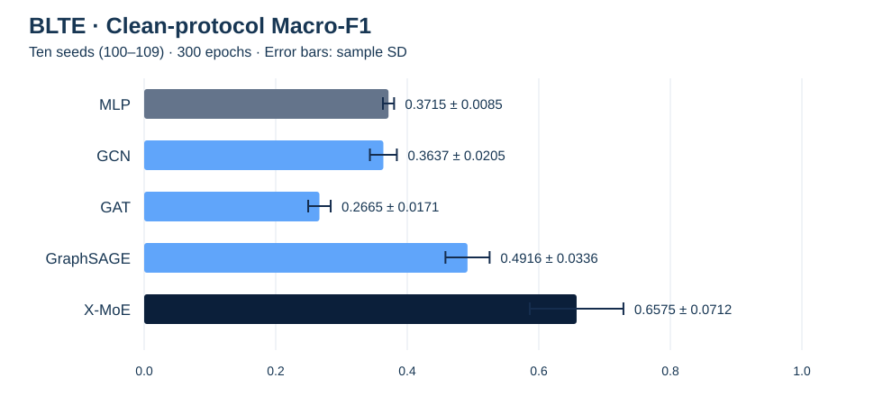
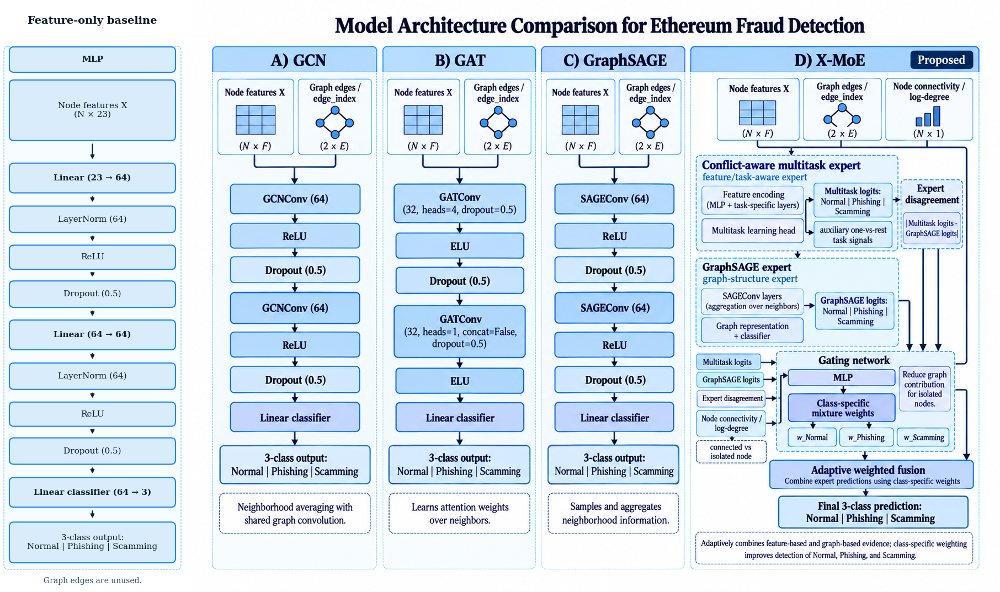
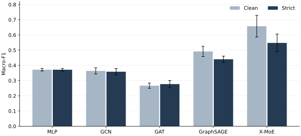

# X-MoE for Ethereum Fraud Detection

This repository provides a reproducible implementation for multi-class Ethereum address fraud detection under severe class imbalance and sparse graph connectivity. It includes conventional graph baselines, a feature-only MLP baseline, the proposed X-MoE framework, manuscript-aligned ablation and sensitivity experiments, strict node-inductive evaluation, reference result summaries, and metric-audit utilities.

## ScamSweeper RQ1 artifact reproduction

To reproduce the released RQ1 graph statistics from a clean Windows or Linux
machine, follow the dedicated [RQ1 from-scratch guide](scamsweeper_reproduction/RQ1_FROM_SCRATCH.md).
The guide includes environment detection, a no-root Node.js setup, audited
dataset hashes, complete node/edge scans, Table I verification, and figure
generation. RQ1 is CPU/RAM/storage-bound and does not require a GPU.

The [ScamSweeper reproducibility status](scamsweeper_reproduction/SCAMSWEEPER_RELEASE_AUDIT.md)
states which released paper results can be reproduced and why RQ2/RQ3 model
comparisons are not reported.


## Dataset Navigation — BLTE and ScamSweeper

This README retains the original complete BLTE instructions and adds a separate, complete ScamSweeper/RQ1 GPU guide.

| Dataset / scope | Read this section | Code | Results |
|---|---|---|---|
| BLTE: original detailed instructions | [Part I — BLTE](#part-i--blte-original-detailed-guide) | [experiments/blte](experiments/blte/README.md) | [results/blte](results/blte/README.md) |
| ScamSweeper/RQ1: step-by-step H200 GPU instructions | [Part II — ScamSweeper](#part-ii--scamsweeper--rq1-complete-gpu-reproduction-guide) | [experiments/scamsweeper](experiments/scamsweeper/README.md) | [results/scamsweeper](results/scamsweeper/README.md) |

Part I preserves the BLTE guide, commands, architecture descriptions and result tables. Its historical statements about a BLTE-only main branch refer to the pre-integration snapshot; main now also contains the separate ScamSweeper suite in Part II. The environments, dataset features and ablation conclusions must be read within their own dataset sections.

# Part I — BLTE: Original Detailed Guide

## Audited Accuracy, Precision, Recall, F1 and ROC-AUC

Updated 2026-11-12: completed per-seed and per-class metrics are available in [the audit report](docs/COMPLETED_METRICS.md) and [aggregate CSV files](results/metrics_completion). AUC and F1 within each run use the same saved test probabilities. The table below reports percentages (0–100), as mean ± sample SD over ten seeds (100–109), for the BLTE clean CPU series. [Definitions and read-only checks](docs/METRIC_METHODS.md) document provenance and evidence limits.

| Entry | Accuracy | Macro Precision | Macro Recall | Macro-F1 | Macro ROC-AUC OvR |
|---|---:|---:|---:|---:|---:|
| MLP | 96.72 ± 0.81 | 35.72 ± 0.51 | 61.27 ± 6.53 | 37.15 ± 0.85 | 91.24 ± 6.09 |
| GCN | 88.11 ± 3.29 | 36.22 ± 1.41 | 74.41 ± 3.89 | 36.37 ± 2.05 | 94.29 ± 2.25 |
| GAT | 59.17 ± 3.36 | 34.35 ± 0.65 | 58.35 ± 8.57 | 26.65 ± 1.71 | 81.79 ± 3.38 |
| GraphSAGE | 98.82 ± 0.21 | 44.39 ± 3.79 | 74.55 ± 7.34 | 49.16 ± 3.36 | 95.58 ± 3.29 |
| X-MoE | 99.69 ± 0.12 | 63.93 ± 6.68 | 75.41 ± 7.15 | 65.75 ± 7.12 | 99.05 ± 0.81 |

BLTE clean, strict, A0–A7, sensitivity and historical CPU/GPU metrics are covered. Supplementary score-reproducing runs and A0/A6 reuse are explicitly attributed in the audit report. Historical tables and training sources remain intact.


## How to use this guide

This guide reproduces the experiments reported in this repository using processed
BLTE inputs. Commands below use **Windows PowerShell**, run from the repository
root on branch `main`. Copy each block separately and wait for completion.
A backtick must be the final character on a continued PowerShell command line.

1. Clone the repository and create the CPU environment.
2. Install dependencies and verify the BLTE artifact hashes.
3. Run a smoke test to check the pipeline; its scores are not final results.
4. Run all five clean CPU models using ten seeds and 300 epochs.
5. Run the strict, ablation and sensitivity experiments where required.
6. Use a separate GPU environment for CUDA runs.
7. Compare newly generated metrics with frozen evidence; keep new outputs separate.

CPU is sufficient for the reported five-model CPU series. GPU commands require
an NVIDIA CUDA-capable device and a compatible driver. The recorded GPU evidence
covers four models; an MLP GPU command is provided as an additional runnable
experiment, without implying that an MLP GPU reference result exists.

## Models

The main public reproduction runner exposes five models:

- MLP — feature-only baseline
- GCN
- GAT
- GraphSAGE
- X-MoE — proposed task-aware mixture-of-experts framework

The models perform three-class classification:

- Normal
- Phishing
- Scamming

The MLP uses node features only and ignores graph edges. GCN, GAT, and GraphSAGE are graph-learning baselines. X-MoE combines feature/task-aware and graph-structural evidence through adaptive routing.


## Five-model BLTE comparison



Bars show mean Macro-F1 and error bars show sample standard deviation across
seeds 100–109, with 300 epochs per run. The values are experimental aggregates;
individual checkpoint predictions do not replace these estimates.

The active MLP ten-seed evidence is in `results/clean/reference/mlp_10seed.csv`.
This `main` release covers BLTE. The `two-dataset-comparison` branch is a separate
workstream; its experiments are outside the reproduction commands in this guide.

## Dataset Summary

The study uses processed BLTE artifacts released by the upstream project. The repository does not independently reconstruct the raw Ethereum collection or labelling pipeline.

Dataset size:

- 73,033 Ethereum addresses
- 72,865 Normal
- 69 Phishing
- 99 Scamming
- 23 node features
- 6,588 released directed edges
- approximately 92.32% isolated nodes

The severe imbalance and sparse connectivity motivate the use of Macro-F1 as the primary comparison metric and motivate X-MoE's isolate-safe routing design.

### BLTE Input Features

The BLTE model inputs comprise the following 23 features in CSV column order. The BLTE CSV supplies the raw feature values. Under the `clean` protocol, the runner fits `StandardScaler` on training nodes and applies the fitted transformation to the validation and test nodes.

| Positions | Features in input order |
|---|---|
| 1–5 | `all_degree`, `in_degree`, `out_degree`, `unique in_degree`, `unique out_degree` |
| 6–9 | `Avg amount incoming`, `Avg amount outgoing`, `Total amount incoming`, `Total amount outgoing` |
| 10–13 | `Max amount incoming`, `Max amount outgoing`, `Min amount incoming`, `Min amount outgoing` |
| 14–18 | `Avg time incoming`, `Avg time outgoing`, `Total transaction time`, `Active Duration`, `Clustering coefficient` |
| 19–23 | `Mean time interval`, `Max time interval`, `Min time interval`, `Avg gas price`, `Avg gas limit` |

These experiments use the released BLTE features and graph. Feature equivalence for newly queried Etherscan addresses has yet to be established.

## Architecture Comparison

The figure below compares all five models. MLP uses node attributes only; the remaining models also use graph structure.



All five models solve the same three-class classification problem, but they differ in how node features and graph information are processed.

### A) MLP

The MLP is a feature-only baseline. It receives the same 23 node features but does not perform message passing and does not use graph edges for prediction.

The implemented pipeline is:

```text
Node features (23)
        |
        v
   Linear(64)
        |
    LayerNorm
        |
       ReLU
        |
   Dropout(0.5)
        |
        v
   Linear(64)
        |
    LayerNorm
        |
       ReLU
        |
   Dropout(0.5)
        |
        v
 Linear classifier
        |
        v
Normal | Phishing | Scamming
```

This baseline is important because approximately 92.32% of the addresses are isolated in the released topology. It provides a direct comparison between feature-only learning and graph-based learning.

### B) GCN

The Graph Convolutional Network (GCN) propagates and aggregates information from neighbouring addresses using shared graph convolution.

```text
Node features + graph edges
        |
        v
   GCNConv(64)
        |
       ReLU
        |
   Dropout(0.5)
        |
        v
   GCNConv(64)
        |
       ReLU
        |
   Dropout(0.5)
        |
 Linear classifier
        |
        v
Normal | Phishing | Scamming
```

GCN provides a simple mechanism for incorporating graph structure. However, neighbourhood information is aggregated using the same convolutional mechanism for all nodes. In highly imbalanced fraud detection, minority-class signals can therefore be difficult to preserve when fraudulent addresses are sparse relative to the Normal class.

### C) GAT

The Graph Attention Network (GAT) extends neighbourhood aggregation by learning attention weights over neighbouring nodes.

```text
Node features + graph edges
        |
   Dropout(0.5) on node features
        |
        v
GATConv(32, heads=4)
        |
       ELU
        |
   Dropout(0.5)
        |
        v
GATConv(32, heads=1)
        |
       ELU
        |
 Linear classifier
        |
        v
Normal | Phishing | Scamming
```

GAT learns attention weights over neighbouring addresses, while GCN uses degree-based convolutional normalisation. Both GATConv layers also use attention dropout of 0.5. Attention provides additional flexibility, but does not explicitly address severe class imbalance, expert disagreement, or the fact that some Ethereum addresses may have little or no useful neighbourhood structure.

### D) GraphSAGE

GraphSAGE learns node representations by aggregating information from local neighbourhoods.

```text
Node features + graph edges
        |
        v
   SAGEConv(64)
        |
       ReLU
        |
   Dropout(0.5)
        |
        v
   SAGEConv(64)
        |
       ReLU
        |
   Dropout(0.5)
        |
 Linear classifier
        |
        v
Normal | Phishing | Scamming
```

GraphSAGE is the strongest conventional GNN baseline in the verified CPU experiments. Its neighbourhood aggregation is effective for learning relational fraud patterns when meaningful graph connectivity exists. However, it still relies on a single graph-learning mechanism and can be less useful when an address is isolated or when discriminative evidence is primarily contained in node-level features.

### E) X-MoE: Proposed Architecture

X-MoE differs from the conventional baselines by combining complementary evidence pathways through adaptive mixture-of-experts routing.

```text
                         Node features
                              |
                  +-----------+-----------+
                  |                       |
                  v                       v
        Conflict-Aware              GraphSAGE
        Multitask Expert               Expert
                  |                       |
                  v                       v
           Expert 1 logits         Expert 2 logits
                  |                       |
                  +-----------+-----------+
                              |
                    Expert disagreement
                              |
                 Node connectivity / degree
                              |
                              v
                       Gating network
                              |
                              v
                 Class-specific mixture
                         weights
             w_Normal | w_Phishing | w_Scamming
                              |
                              v
                  Adaptive weighted fusion
                              |
                              v
               Normal | Phishing | Scamming
```

#### Expert 1: Conflict-Aware Multitask Expert

The first expert contains a feature branch and an internal GraphSAGE branch. A class-specific inner gate combines these representations using feature evidence, graph evidence, and log degree. This expert is trained with the primary weighted multiclass objective and class-focused auxiliary objectives.

#### Expert 2: GraphSAGE Expert

The second expert is an independently parameterised GraphSAGE model. It captures relational information from neighbouring Ethereum addresses and produces its own three-class prediction.

#### Expert disagreement

X-MoE explicitly incorporates the absolute disagreement between the two expert logits:

```text
| Expert 1 logits - Expert 2 logits |
```

Disagreement is supplied to the outer gate together with the two expert outputs and degree information.

#### Connectivity-aware and isolate-safe routing

A key design feature is that graph-based contribution is explicitly suppressed for isolated nodes. If a node has zero degree, the graph contribution is set to zero so the isolated-node prediction reduces to the feature pathway rather than relying on an uninformative neighbourhood representation.

#### Class-specific mixture weights

X-MoE does not use one global mixture weight. It learns separate routing weights for Normal, Phishing, and Scamming so the relative importance of the experts can vary by class.

Routing weights are interpreted as model diagnostics, not as causal explanations.

### Why the X-MoE Architecture Helps Fraud Detection

The central motivation is that no single source of evidence is equally reliable for every Ethereum address.

For a strongly connected address, graph relationships may contain useful fraud evidence. For an isolated or weakly connected address, node-level features may be more informative than message passing. For difficult minority-class cases, expert disagreement can help the gate decide which evidence source should receive greater weight.

X-MoE therefore combines:

1. feature/task-aware evidence;
2. graph-structural evidence;
3. disagreement between experts; and
4. node connectivity.

This produces an adaptive decision mechanism rather than applying the same graph-learning rule to every address.

## Main Clean-Protocol Results

The verified deterministic CPU experiment uses seeds 100–109 and 300 epochs per seed. Values in this section are fractions (0–1), reported as mean ± sample SD where shown.

| Model | Accuracy (mean ± std) | Macro-F1 (mean ± std) |
|---|---:|---:|
| GCN | 0.881123 ± 0.032853 | 0.363689 ± 0.020485 |
| GAT | 0.591693 ± 0.033604 | 0.266492 ± 0.017115 |
| MLP | 0.967175 ± 0.008147 | 0.371498 ± 0.008483 |
| GraphSAGE | 0.988188 ± 0.002071 | 0.491619 ± 0.033561 |
| **X-MoE** | **0.996942 ± 0.001153** | **0.657494 ± 0.071187** |

Relative to GraphSAGE, X-MoE improves mean Macro-F1 by:

```text
0.657494 - 0.491619 = 0.165875
```

which is approximately:

```text
+16.59 percentage points
+33.74% relative improvement
```

Accuracy is reported for completeness. Because the dataset is extremely imbalanced, Macro-F1 is the primary comparison metric.

### Class-Specific F1

| Model | Normal F1 | Phishing F1 | Scamming F1 |
|---|---:|---:|---:|
| GCN | 0.9367 | 0.0132 | 0.1412 |
| GAT | 0.7430 | 0.0036 | 0.0528 |
| MLP | 0.9837 | 0.0434 | 0.0874 |
| GraphSAGE | 0.9944 | 0.1023 | 0.3782 |
| **X-MoE** | **0.9988** | **0.5374** | **0.4363** |

These are mean class-specific F1 scores over ten seeds. Relative to GraphSAGE, the larger minority-class F1 improvement is observed for Phishing.

## Paired Statistical Comparison

The clean baseline analysis uses paired seed-level Macro-F1, two-sided exact Wilcoxon signed-rank tests, Holm correction across the four baseline comparisons, paired effect size d_z, and paired mean-difference confidence intervals. The ablation analysis instead uses an exact paired sign-flip test with Holm correction across seven comparisons; these are separate test families.

| Comparison | Δ Macro-F1 | 95% CI | Holm-adjusted p | d_z | X-MoE wins |
|---|---:|---:|---:|---:|---:|
| X-MoE vs GCN | 0.2938 | [0.2450, 0.3426] | 0.007812 | 4.309 | 10/10 |
| X-MoE vs GAT | 0.3910 | [0.3382, 0.4438] | 0.007812 | 5.299 | 10/10 |
| X-MoE vs MLP | 0.2860 | [0.2387, 0.3333] | 0.007812 | 4.323 | 10/10 |
| X-MoE vs GraphSAGE | 0.1659 | [0.1216, 0.2101] | 0.007812 | 2.681 | 10/10 |

## CPU Reproduction Status

The CPU experiments were reproduced using:

- Python 3.11.9
- pip 24.0
- PyTorch 2.14.1+cpu
- PyTorch Geometric 2.8.0.post1
- NumPy 2.4.6
- Pandas 3.0.6
- scikit-learn 1.9.1
- SciPy 1.17.1
- CPU execution
- clean protocol
- 300 epochs
- seeds 100–109

## Repository Structure

| Path on `main` | Purpose |
|---|---|
| `src/runner.py` | Clean training and evaluation for five models |
| `src/models/` | MLP, GCN, GAT, GraphSAGE and X-MoE implementations |
| `experiments/ablation.py` | Component and connectivity analyses |
| `experiments/strict_inductive.py` | Restricted-topology evaluation |
| `experiments/summarize_results.py` | Frozen-evidence table builder |
| `requirements-cpu.txt`, `requirements-gpu.txt` | Recorded dependency snapshots |
| `ENVIRONMENT_CPU.txt`, `ENVIRONMENT_GPU.txt` | Recorded environment details |
| `results/clean/reference/` | Clean seed-level results for five models |
| `results/strict/reference/` | Strict 50-run aggregate and statistics |
| `results/strict/runs/` | Three evidence files for each model/seed pair |
| `results/ablation/reference/` | Ablation evidence |
| `results/cpu_gpu/` | CPU/GPU comparison summaries |
| `results/sensitivity/` | Sensitivity evidence |
| `results/tables/` | Reporting tables |
| `figures/` | Architecture and performance figures |
| `RESULT_SOURCE_HASHES.json` | Evidence hashes |
| `FILE_RELOCATION_MAP.json` | Historical-to-current path mapping |

At the documentation audit on 16 November 2026, the repository has three branches:

| Branch | Scope |
|---|---|
| `main` | BLTE experiment code, reference results, metric audits, tables and figures documented here |
| `reproduction` | Separate reconstructed BLTE reproduction and PCGrad ablation workstream |
| `two-dataset-comparison` | Separate dataset-comparison workstream |

`main` contains no Streamlit application source or packaged inference checkpoints.
The paper's LaTeX is maintained separately.
`src/models/__init__.py` exports model classes; run experiments through the runner.

# Step-by-Step CPU Reproduction

## 1. Clone This Repository

```powershell
git clone --branch main --single-branch https://github.com/nurhalizaabdulwahab197/xmoe-ethereum-fraud-detection.git
cd xmoe-ethereum-fraud-detection
```

## 2. Python Environment

The verified CPU environment uses Python 3.11.9.

Check installed Python versions:

```powershell
py -0p
```

Create the virtual environment:

```powershell
py -3.11 -m venv .venv-cpu
```

If PowerShell blocks activation:

```powershell
Set-ExecutionPolicy -Scope Process -ExecutionPolicy Bypass
```

Activate:

```powershell
.\.venv-cpu\Scripts\Activate.ps1
```

Verify:

```powershell
python --version
python -m pip --version
```

Expected:

```text
Python 3.11.9
pip 24.0
```

For strict reproduction of the tested CPU environment, do not upgrade pip before installing the tested requirements.

## 3. Install CPU Dependencies

Pin the recorded installer version inside the activated environment:

```powershell
python -m pip install pip==24.0
```

```powershell
python -m pip install -r .\requirements-cpu.txt
```

Verify the main packages:

```powershell
python -c "import torch, torch_geometric, numpy, pandas, sklearn, scipy; print('torch=' + torch.__version__); print('torch-geometric=' + torch_geometric.__version__); print('numpy=' + numpy.__version__); print('pandas=' + pandas.__version__); print('sklearn=' + sklearn.__version__); print('scipy=' + scipy.__version__); print('cuda=' + str(torch.cuda.is_available()))"
```

Expected tested CPU configuration:

```text
torch=2.14.1+cpu
torch-geometric=2.8.0.post1
numpy=2.4.6
pandas=3.0.6
sklearn=1.9.1
scipy=1.17.1
cuda=False
```

`pip freeze` records the installed package metadata as `torch==2.14.1`, while the PyTorch runtime reports `torch.__version__ == 2.14.1+cpu`. These refer to the same verified CPU environment.

A PyTorch Geometric `torch.jit.script` FutureWarning may appear. It does not prevent the experiments from running.

## 4. Obtain the BLTE Dataset Artifacts

Clone the upstream repository:

```powershell
git clone https://github.com/salam-ammari/Graph-Neural-Network-Based-Fraudulent-Address-Classification-in-Ethereum-Network.git upstream-paper
```

Required artifacts:

```text
upstream-paper/BLTE_multiclass_graph.pt
upstream-paper/BLTE_multiclass_v2.csv
```

Verify SHA-256:

```powershell
Get-FileHash `
  .\upstream-paper\BLTE_multiclass_graph.pt, `
  .\upstream-paper\BLTE_multiclass_v2.csv `
  -Algorithm SHA256
```

Expected hashes:

```text
BLTE_multiclass_graph.pt
2859A8A3A815EDD02B5CD85D46C00D730B2B66C4E8D047145DB2E843C9E38456

BLTE_multiclass_v2.csv
02E376DDD98BA595372F19731FE5E51BBC90BF897B2A52B3C8BB98E786423B11
```

The upstream dataset directory is intentionally excluded from this repository.

## 5. Verify Available Models

```powershell
python .\src\runner.py --help
```

Expected model choices:

```text
{gcn,gat,graphsage,mlp,x_moe_gnn}
```

## 6. Smoke Tests

Smoke tests use seed 100 and 10 epochs. They verify that each training pipeline runs successfully. They are not final performance measurements.

### MLP

```powershell
python .\src\runner.py `
  --model mlp `
  --protocol clean `
  --seeds 100 `
  --epochs 10 `
  --device cpu `
  --upstream .\upstream-paper `
  --output-dir .\results\new_runs\cpu\smoke\mlp `
  --no-save-checkpoints `
  --no-save-predictions
```

### GCN

```powershell
python .\src\runner.py `
  --model gcn `
  --protocol clean `
  --seeds 100 `
  --epochs 10 `
  --device cpu `
  --upstream .\upstream-paper `
  --output-dir .\results\new_runs\cpu\smoke\gcn `
  --no-save-checkpoints `
  --no-save-predictions
```

### GAT

```powershell
python .\src\runner.py `
  --model gat `
  --protocol clean `
  --seeds 100 `
  --epochs 10 `
  --device cpu `
  --upstream .\upstream-paper `
  --output-dir .\results\new_runs\cpu\smoke\gat `
  --no-save-checkpoints `
  --no-save-predictions
```

### GraphSAGE

```powershell
python .\src\runner.py `
  --model graphsage `
  --protocol clean `
  --seeds 100 `
  --epochs 10 `
  --device cpu `
  --upstream .\upstream-paper `
  --output-dir .\results\new_runs\cpu\smoke\graphsage `
  --no-save-checkpoints `
  --no-save-predictions
```

### X-MoE

```powershell
python .\src\runner.py `
  --model x_moe_gnn `
  --protocol clean `
  --seeds 100 `
  --epochs 10 `
  --device cpu `
  --upstream .\upstream-paper `
  --x-moe-normal-phishing-penalty 0.30 `
  --output-dir .\results\new_runs\cpu\smoke\xmoe `
  --no-save-checkpoints `
  --no-save-predictions
```

### Smoke-Test Reference Results

The following deterministic CPU values are implementation checks, not final scientific performance evidence.

| Model | Accuracy | Macro-F1 |
|---|---:|---:|
| GCN | 0.064993 | 0.041525 |
| GAT | 0.528982 | 0.242811 |
| GraphSAGE | 0.001461 | 0.011117 |
| **X-MoE** | **0.926883** | **0.390384** |

The documented historical smoke reference does not include MLP. For MLP, successful execution and output generation are the implementation checks; final MLP performance is reported from the 10-seed experiment below.

## 7. Full 10-Seed CPU Reproduction

All final CPU experiments use:

```text
protocol = clean
seeds = 100,101,102,103,104,105,106,107,108,109
epochs = 300
device = cpu
deterministic = enabled
```

### MLP

```powershell
python .\src\runner.py `
  --model mlp `
  --protocol clean `
  --seeds 100,101,102,103,104,105,106,107,108,109 `
  --epochs 300 `
  --device cpu `
  --deterministic `
  --upstream .\upstream-paper `
  --output-dir .\results\new_runs\cpu\clean\mlp `
  --save-checkpoints `
  --save-predictions
```

Reference summary:

```text
Accuracy = 0.967175 ± 0.008147
Macro-F1 = 0.371498 ± 0.008483
```

### GCN

```powershell
python .\src\runner.py `
  --model gcn `
  --protocol clean `
  --seeds 100,101,102,103,104,105,106,107,108,109 `
  --epochs 300 `
  --device cpu `
  --deterministic `
  --upstream .\upstream-paper `
  --output-dir .\results\new_runs\cpu\clean\gcn `
  --save-checkpoints `
  --save-predictions
```

Reference summary:

```text
Accuracy = 0.881123 ± 0.032853
Macro-F1 = 0.363689 ± 0.020485
```

### GAT

```powershell
python .\src\runner.py `
  --model gat `
  --protocol clean `
  --seeds 100,101,102,103,104,105,106,107,108,109 `
  --epochs 300 `
  --device cpu `
  --deterministic `
  --upstream .\upstream-paper `
  --output-dir .\results\new_runs\cpu\clean\gat `
  --save-checkpoints `
  --save-predictions
```

Reference summary:

```text
Accuracy = 0.591693 ± 0.033604
Macro-F1 = 0.266492 ± 0.017115
```

### GraphSAGE

```powershell
python .\src\runner.py `
  --model graphsage `
  --protocol clean `
  --seeds 100,101,102,103,104,105,106,107,108,109 `
  --epochs 300 `
  --device cpu `
  --deterministic `
  --upstream .\upstream-paper `
  --output-dir .\results\new_runs\cpu\clean\graphsage `
  --save-checkpoints `
  --save-predictions
```

Reference summary:

```text
Accuracy = 0.988188 ± 0.002071
Macro-F1 = 0.491619 ± 0.033561
```

### X-MoE

```powershell
python .\src\runner.py `
  --model x_moe_gnn `
  --protocol clean `
  --seeds 100,101,102,103,104,105,106,107,108,109 `
  --epochs 300 `
  --device cpu `
  --deterministic `
  --upstream .\upstream-paper `
  --x-moe-normal-phishing-penalty 0.30 `
  --output-dir .\results\new_runs\cpu\clean\xmoe `
  --save-checkpoints `
  --save-predictions
```

Reference summary:

```text
Accuracy = 0.996942 ± 0.001153
Macro-F1 = 0.657494 ± 0.071187
```

## 8. Clean Protocol

For every seed, the `clean` protocol:

1. regenerates a stratified 70/15/15 train/validation/test split;
2. fits `StandardScaler` on training nodes only;
3. applies the fitted scaler to validation and test nodes;
4. retains the released BLTE topology across node partitions;
5. trains for 300 epochs;
6. selects the checkpoint with the highest validation Macro-F1; and
7. evaluates once on the held-out test partition.

This main protocol is topology-visible because the released topology is retained. It should not be described as strict node-inductive.

## 9. Interpretation of the CPU Results

The primary comparison is between X-MoE and GraphSAGE, the strongest conventional GNN baseline by mean Macro-F1.

```text
GraphSAGE Macro-F1 = 0.491619
X-MoE Macro-F1     = 0.657494

Absolute improvement = 0.165875
Percentage-point improvement = 16.59
Relative improvement ≈ 33.74%
```

The MLP result provides an additional feature-only control. Its mean Macro-F1 of 0.371498 exceeds GCN in this sparse graph setting but remains substantially below GraphSAGE and X-MoE.

## 10. X-MoE Reference Training Configuration

```text
base_loss = weighted_ce
expert_loss_weight = 0.25
scam_specialist_loss_weight = 0.50
x_moe_expert_task_loss_weight = 1.00
x_moe_normal_phishing_penalty = 0.30
optimizer = Adam
learning_rate = 0.001
weight_decay = 0.0005
hidden_channels = 64
dropout = 0.5
outer_gate_hidden = 32
```

The reference Normal–Phishing coefficient λ_NP = 0.30 is a manuscript reference setting, not a uniquely optimal coefficient.

## 11. Ablation Study: A0–A7

The A0–A7 ablation below uses the main study protocol. The `reproduction` branch reports a separate PCGrad ON/OFF ablation under two reconstructed BLTE configurations. [PCGrad ablation results](https://github.com/nurhalizaabdulwahab197/xmoe-ethereum-fraud-detection/blob/reproduction/README.md#pcgrad-ablation)

Runner:

```text
experiments/ablation.py
```

Check available options:

```powershell
python .\experiments\ablation.py --help
```

Reference results:

| Variant | Mean Macro-F1 | Δ vs A0 |
|---|---:|---:|
| A0 Full X-MoE | 0.6575 | — |
| A1 Conflict-Aware only | 0.6525 | -0.0050 |
| A2 GraphSAGE-expert configuration | 0.6558 | -0.0017 |
| A3 Shared routing | 0.6917 | +0.0342 |
| A4 No isolate masking | 0.7071 | +0.0496 |
| A5 No Scamming specialist | 0.6557 | -0.0018 |
| A6 No Normal–Phishing objective | 0.5526 | -0.1049 |
| A7 Fixed 50:50 outer mixture | 0.6912 | +0.0337 |

A0 is the reference architecture, not the numerically best ablation. A3, A4, and A7 obtain higher mean Macro-F1 than A0. Only A6 shows a family-wise significant overall degradation after Holm correction, indicating that removing the Normal–Phishing objective has the clearest adverse effect in this experiment.

### Run the full eight-variant ablation study

This command requests eight variants across ten seeds: 80 training runs.
Use the explicit 300 epochs below; the script default is a shorter test run.

```powershell
python .\experiments\ablation.py `
  --variant all `
  --protocol clean `
  --seeds 100,101,102,103,104,105,106,107,108,109 `
  --epochs 300 `
  --device cpu `
  --deterministic `
  --upstream .\upstream-paper `
  --expert-loss-weight 0.25 `
  --scam-specialist-loss-weight 0.50 `
  --expert-task-loss-weight 1.00 `
  --normal-phishing-penalty 0.30 `
  --output-dir .\results\new_runs\cpu\ablation
```

To rerun one variant, replace `--variant all` with, for example,
`--variant a6_no_normal_phishing_penalty` and use a new output directory.
For a pipeline test use `--seeds 100 --epochs 2`; do not compare a two-epoch
smoke test with the reported 300-epoch ablation scores.

## 12. Connectivity-Stratified Analysis

The ablation runner also reports connected/isolated subgroup behaviour. No separate connectivity runner is required.

| Metric | Full X-MoE | No isolate masking |
|---|---:|---:|
| Connected-node Macro-F1 | 0.6524 | 0.7273 |
| Connected Phishing F1 | 0.5374 | 0.5576 |
| Connected Scamming F1 | 0.4363 | 0.6301 |
| Isolated Normal FPR | 0.000000 | 0.000307 |

Removing isolate masking improves connected-node discrimination but introduces a small false-positive cost among isolated Normal addresses. All fraud test nodes in this analysis are connected, so the isolated subgroup contains only Normal nodes. The result is therefore interpreted as a performance–safety trade-off rather than simple superiority of either configuration.

## 13. Normal–Phishing Coefficient Sensitivity

The sensitivity experiments can be reproduced with `src/runner.py` by changing:

```text
--x-moe-normal-phishing-penalty
```

while keeping the remaining clean-protocol settings fixed.

| λ_NP | Macro-F1 | Phishing F1 | Scamming F1 |
|---:|---:|---:|---:|
| 0.00 | 0.5526 ± 0.0451 | 0.2379 ± 0.0766 | 0.4226 ± 0.1082 |
| 0.10 | 0.6489 ± 0.0662 | 0.5438 ± 0.1363 | 0.4044 ± 0.1007 |
| **0.30** | 0.6575 ± 0.0712 | 0.5374 ± 0.1433 | **0.4363 ± 0.1010** |
| 0.50 | **0.6580 ± 0.0746** | **0.5551 ± 0.1647** | 0.4203 ± 0.1174 |
| 1.00 | 0.6523 ± 0.0776 | 0.5402 ± 0.1569 | 0.4180 ± 0.1255 |

The main sensitivity occurs when the objective is removed. Positive values from 0.10 to 1.00 form a broad high-performing region. λ_NP = 0.30 is retained as the reference setting and is not claimed as the unique optimum.

Machine-readable summary:

```text
results/sensitivity/lambda/summary.csv
```

### Commands for each sensitivity coefficient

Each block runs X-MoE for ten seeds. Together the five blocks request 50 runs.
All other settings are held fixed. Activate `.venv-cpu` before running them.
The published metric-completion audit reuses A6 for λ=0.00 and A0 for λ=0.30;
those 20 rows are shared evidence, not additional independent trials.

#### Coefficient 0.00

```powershell
python .\src\runner.py `
  --model x_moe_gnn `
  --protocol clean `
  --seeds 100,101,102,103,104,105,106,107,108,109 `
  --epochs 300 `
  --device cpu `
  --deterministic `
  --upstream .\upstream-paper `
  --x-moe-normal-phishing-penalty 0.00 `
  --output-dir .\results\new_runs\cpu\sensitivity\lambda_0.00 `
  --save-checkpoints `
  --save-predictions
```

#### Coefficient 0.10

```powershell
python .\src\runner.py `
  --model x_moe_gnn `
  --protocol clean `
  --seeds 100,101,102,103,104,105,106,107,108,109 `
  --epochs 300 `
  --device cpu `
  --deterministic `
  --upstream .\upstream-paper `
  --x-moe-normal-phishing-penalty 0.10 `
  --output-dir .\results\new_runs\cpu\sensitivity\lambda_0.10 `
  --save-checkpoints `
  --save-predictions
```

#### Coefficient 0.30

```powershell
python .\src\runner.py `
  --model x_moe_gnn `
  --protocol clean `
  --seeds 100,101,102,103,104,105,106,107,108,109 `
  --epochs 300 `
  --device cpu `
  --deterministic `
  --upstream .\upstream-paper `
  --x-moe-normal-phishing-penalty 0.30 `
  --output-dir .\results\new_runs\cpu\sensitivity\lambda_0.30 `
  --save-checkpoints `
  --save-predictions
```

#### Coefficient 0.50

```powershell
python .\src\runner.py `
  --model x_moe_gnn `
  --protocol clean `
  --seeds 100,101,102,103,104,105,106,107,108,109 `
  --epochs 300 `
  --device cpu `
  --deterministic `
  --upstream .\upstream-paper `
  --x-moe-normal-phishing-penalty 0.50 `
  --output-dir .\results\new_runs\cpu\sensitivity\lambda_0.50 `
  --save-checkpoints `
  --save-predictions
```

#### Coefficient 1.00

```powershell
python .\src\runner.py `
  --model x_moe_gnn `
  --protocol clean `
  --seeds 100,101,102,103,104,105,106,107,108,109 `
  --epochs 300 `
  --device cpu `
  --deterministic `
  --upstream .\upstream-paper `
  --x-moe-normal-phishing-penalty 1.00 `
  --output-dir .\results\new_runs\cpu\sensitivity\lambda_1.00 `
  --save-checkpoints `
  --save-predictions
```

## 14. STRICT-INDUCTIVE Evaluation

Runner:

```text
experiments/strict_inductive.py
```

Display label:

```text
STRICT-INDUCTIVE
```

Code protocol key:

```text
strict_inductive
```

Check runner options:

```powershell
python .\experiments\strict_inductive.py --help
```

Protocol visibility:

- Training: training features and train–train topology only.
- Validation: train + validation features; train–train, train–validation and validation–train edges; excludes validation–validation edges and all test nodes/edges.
- Test: train + test features; train–train, train–test and test–train edges; excludes test–test edges and all validation nodes/edges.
- The released edge direction is preserved.
- No synthetic reverse edges are added.
- Hard leakage assertions are included in the runner.

Verified Macro-F1:

| Model | STRICT-INDUCTIVE Macro-F1 |
|---|---:|
| MLP | 0.371498 ± 0.008483 |
| GCN | 0.358331 ± 0.020646 |
| GAT | 0.277051 ± 0.023603 |
| GraphSAGE | 0.440139 ± 0.020355 |
| **X-MoE** | **0.547783 ± 0.058151** |

X-MoE exceeds MLP, GCN, GAT and GraphSAGE in all ten matched seeds under this protocol. Each exact paired Wilcoxon comparison has raw p = 0.001953125 and Holm-adjusted p = 0.0078125 across four baselines.

All five models were evaluated using strict seeds 100–109. MLP's seed-level Macro-F1 equals its clean result for every seed; MLP does not use graph edges. The five-model strict evidence is in `results/strict/reference/strict_50_runs.csv`.



The clean-to-strict family contains five models. Adjusted p-values are MLP 1.000000, GCN 0.644531, GAT 0.058594, GraphSAGE 0.009766 and X-MoE 0.015625. GAT's increase is not significant at 0.05. GraphSAGE and X-MoE decrease significantly.

Use the per-model commands below to run the strict experiments. To check or
rebuild the curated tables from frozen reference CSVs without training, use
[`experiments/summarize_results.py`](experiments/summarize_results.py) as shown
in [Checking generated results](#checking-generated-results). This utility does
not automatically promote a new experiment. For the strict minority comparison
against GraphSAGE, Holm correction is applied separately across Phishing F1/AP
and Scamming F1/AP: adjusted p = 0.0078125, 0.0078125, 0.275390625 and 0.02734375,
respectively.

STRICT-INDUCTIVE is a topology-visibility sensitivity analysis. It is not evidence of temporal, cross-chain, or cross-dataset generalisation, and the clean-to-strict change should not be presented as proof of leakage.

### Run all five strict CPU experiments, one model at a time

Activate `.venv-cpu` and run these commands from the `main` repository root.
The script selects the strict protocol internally; it has no `--protocol` flag.
Strict supports saved predictions; its CLI does not expose `--save-checkpoints`.

#### mlp

```powershell
python .\experiments\strict_inductive.py `
  --model mlp `
  --seeds 100,101,102,103,104,105,106,107,108,109 `
  --epochs 300 `
  --device cpu `
  --deterministic `
  --upstream .\upstream-paper `
  --output-dir .\results\new_runs\cpu\strict\mlp `
  --save-predictions
```

#### gcn

```powershell
python .\experiments\strict_inductive.py `
  --model gcn `
  --seeds 100,101,102,103,104,105,106,107,108,109 `
  --epochs 300 `
  --device cpu `
  --deterministic `
  --upstream .\upstream-paper `
  --output-dir .\results\new_runs\cpu\strict\gcn `
  --save-predictions
```

#### gat

```powershell
python .\experiments\strict_inductive.py `
  --model gat `
  --seeds 100,101,102,103,104,105,106,107,108,109 `
  --epochs 300 `
  --device cpu `
  --deterministic `
  --upstream .\upstream-paper `
  --output-dir .\results\new_runs\cpu\strict\gat `
  --save-predictions
```

#### graphsage

```powershell
python .\experiments\strict_inductive.py `
  --model graphsage `
  --seeds 100,101,102,103,104,105,106,107,108,109 `
  --epochs 300 `
  --device cpu `
  --deterministic `
  --upstream .\upstream-paper `
  --output-dir .\results\new_runs\cpu\strict\graphsage `
  --save-predictions
```

#### x_moe_gnn

```powershell
python .\experiments\strict_inductive.py `
  --model x_moe_gnn `
  --seeds 100,101,102,103,104,105,106,107,108,109 `
  --epochs 300 `
  --device cpu `
  --deterministic `
  --upstream .\upstream-paper `
  --x-moe-normal-phishing-penalty 0.30 `
  --output-dir .\results\new_runs\cpu\strict\x_moe_gnn `
  --save-predictions
```

The published strict reference is `results/strict/reference/strict_50_runs.csv`.
New runs are kept separately and do not automatically replace that reference.

## 15. Reproducibility Scope

This repository reproduces experiments using processed BLTE artifacts released by the upstream project. It does not independently reconstruct the complete BLTE dataset from raw blockchain data.

The clean protocol prevents feature-scaling leakage by fitting the scaler on training nodes only, while retaining the released topology. STRICT-INDUCTIVE separately evaluates a stricter node-inductive visibility condition.

Exact bit-for-bit equality across every machine is not guaranteed. Small differences can arise from operating system, CPU/GPU implementation, numerical libraries, thread scheduling, and floating-point behaviour.

## 16. Generated Outputs

When checkpoints and predictions are enabled, the main runner generates per-seed model checkpoints and prediction files. New outputs should be written to a fresh output directory. Published strict metrics, summaries and predictions for all 50 runs are retained under `results/strict/runs/`. Do not overwrite frozen reference evidence with a new run.

Manuscript-facing summaries are stored under:

```text
results/tables/
```

Reference summaries are stored under:

```text
results/clean/reference/
results/strict/reference/
results/ablation/reference/
```

Normal–Phishing sensitivity summary:

```text
results/sensitivity/lambda/summary.csv
```

Important manuscript-facing files include:

```text
results/tables/clean_baseline_10seed.csv
results/tables/minority_class_summary.csv
results/tables/ablation_summary.csv
results/tables/connectivity_analysis.csv
results/tables/efficiency_summary.csv
results/tables/strict_inductive_10seed.csv
results/tables/clean_to_strict_summary.csv
results/tables/statistical_tests.csv
```

## 17. Reproduction Metadata

Exact verified environment details are recorded in:

```text
ENVIRONMENT_CPU.txt
ENVIRONMENT_GPU.txt
requirements-cpu.txt
requirements-gpu.txt
```

## 18. Hosted Research Demo

Previously published research demo URL:

**[X-MoE Ethereum Fraud Detection Demo](https://xmoe-ethereum-fraud-detection.streamlit.app/)**

This is an external deployment reference. Its current availability and deployed
version are not established by this repository audit. The application source,
Streamlit configuration and inference assets are absent from this `main` snapshot,
so this guide provides no local demo launch instructions.

Quantitative claims in this guide use controlled ten-seed experiments. An
individual demo prediction is not a multi-seed performance estimate or a
certification that an arbitrary Ethereum address is safe or fraudulent.

# GPU Reproduction Results

GPU reproduction was independently performed using the same clean protocol, seeds 100–109, and 300 epochs.

Verified historical GPU environment:

```text
GPU: NVIDIA GeForce GTX 1660 SUPER
VRAM: 6 GB
NVIDIA Driver: 595.95
PyTorch: 2.14.1+cu126
CUDA runtime: 12.6
PyTorch Geometric: 2.8.0.post1
Python: 3.11.9
```

## Install the Verified GPU Environment

Before installing GPU dependencies, open a new PowerShell terminal in the
repository root. Use a separate environment so CPU and CUDA packages do not mix.

### 1. Check NVIDIA driver and installed Python

```powershell
nvidia-smi
py -0p
```

The recorded environment uses Python 3.11.9. `py -3.11` selects an installed
3.11 interpreter; check the patch version before comparing environments.
`nvidia-smi` reports driver capability; `torch.version.cuda` below reports the
runtime used by the installed PyTorch build.

### 2. Create and activate the GPU environment

```powershell
py -3.11 -m venv .venv-gpu
```

If PowerShell blocks activation, allow it for this terminal session:

```powershell
Set-ExecutionPolicy -Scope Process -ExecutionPolicy Bypass
```

```powershell
.\.venv-gpu\Scripts\Activate.ps1
python --version
python -m pip --version
python -m pip install pip==24.0
```

### 3. Install the recorded CUDA dependency snapshot

```powershell
python -m pip install -r .\requirements-gpu.txt --extra-index-url https://download.pytorch.org/whl/cu126
```

Verify:

```powershell
python -c "import torch; print('torch=', torch.__version__); print('cuda runtime=', torch.version.cuda); print('cuda available=', torch.cuda.is_available())"
```

Expected tested configuration:

```text
torch=2.14.1+cu126
cuda runtime=12.6
cuda available=True
```

## Reproduce the Historical GPU Experiments

The historical GPU reference predates the manuscript-aligned MLP comparison and therefore contains GCN, GAT, GraphSAGE, and X-MoE only.

### GCN

```powershell
python .\src\runner.py `
  --model gcn `
  --protocol clean `
  --seeds 100,101,102,103,104,105,106,107,108,109 `
  --epochs 300 `
  --device cuda `
  --deterministic `
  --upstream .\upstream-paper `
  --output-dir .\results\new_runs\gpu\clean\gcn `
  --save-checkpoints `
  --save-predictions
```

### GAT

```powershell
python .\src\runner.py `
  --model gat `
  --protocol clean `
  --seeds 100,101,102,103,104,105,106,107,108,109 `
  --epochs 300 `
  --device cuda `
  --deterministic `
  --upstream .\upstream-paper `
  --output-dir .\results\new_runs\gpu\clean\gat `
  --save-checkpoints `
  --save-predictions
```

### GraphSAGE

```powershell
python .\src\runner.py `
  --model graphsage `
  --protocol clean `
  --seeds 100,101,102,103,104,105,106,107,108,109 `
  --epochs 300 `
  --device cuda `
  --deterministic `
  --upstream .\upstream-paper `
  --output-dir .\results\new_runs\gpu\clean\graphsage `
  --save-checkpoints `
  --save-predictions
```

### X-MoE

```powershell
python .\src\runner.py `
  --model x_moe_gnn `
  --protocol clean `
  --seeds 100,101,102,103,104,105,106,107,108,109 `
  --epochs 300 `
  --device cuda `
  --deterministic `
  --upstream .\upstream-paper `
  --x-moe-normal-phishing-penalty 0.30 `
  --output-dir .\results\new_runs\gpu\clean\xmoe `
  --save-checkpoints `
  --save-predictions
```

### MLP: additional GPU experiment

This command uses the same clean settings. There is no frozen MLP GPU result
in the historical four-model comparison; assess this new output separately.

```powershell
python .\src\runner.py `
  --model mlp `
  --protocol clean `
  --seeds 100,101,102,103,104,105,106,107,108,109 `
  --epochs 300 `
  --device cuda `
  --deterministic `
  --upstream .\upstream-paper `
  --output-dir .\results\new_runs\gpu\clean\mlp `
  --save-checkpoints `
  --save-predictions
```
## CPU vs GPU Macro-F1

| Model | CPU Macro-F1 | GPU Macro-F1 |
|---|---:|---:|
| GCN | 0.363689 ± 0.020485 | 0.363670 ± 0.017636 |
| GAT | 0.266492 ± 0.017115 | 0.275000 ± 0.029484 |
| GraphSAGE | 0.491619 ± 0.033561 | 0.495760 ± 0.031397 |
| **X-MoE** | **0.657494 ± 0.071187** | **0.657782 ± 0.065579** |

The historical model ranking is preserved across CPU and GPU environments:

```text
X-MoE > GraphSAGE > GCN > GAT
```

On the tested GPU environment, X-MoE improves mean Macro-F1 over GraphSAGE from 0.495760 to 0.657782, corresponding to an absolute improvement of 0.162022 (+16.20 percentage points), or approximately +32.68% relative improvement.

The CPU and GPU results are closely consistent but are not expected to be bitwise identical. Minor numerical variation can arise from differences between CPU and CUDA execution paths.

## Checking generated results

The clean runner writes a seed-level metrics CSV and a `_summary.csv` containing
mean and sample standard deviation across the requested seeds. With saving
flags enabled, it also writes per-seed checkpoints and test predictions.
A checkpoint is validation-selected; do not select runs by test performance.

For example, after the GCN CPU run:

```powershell
Get-ChildItem .\results\new_runs\cpu\clean\gcn
Get-ChildItem .\results\new_runs\cpu\clean\gcn\*_summary.csv |
    ForEach-Object { Get-Content -LiteralPath $_.FullName }
```

Check all requested seeds are present before comparing means. Compare the same
model, protocol, seeds, epochs, dataset hashes and device. CPU/GPU differences
should be reported separately; exact cross-device equality is not expected.
Use the tables above as reference values, not as hard-coded outputs to recreate.

### Check frozen reference tables without retraining

```powershell
python .\experiments\summarize_results.py --help
python .\experiments\summarize_results.py
```

The summarizer reads frozen reference inputs. It does **not** automatically ingest
your `results/new_runs/` directory. Its default mode validates the frozen seed-level inputs and prints rebuilt reporting tables; it does not compare every existing table file against the rebuilt output.
It rebuilds the strict, clean-to-strict, minority-class and paired-statistics tables,
and can generate `results/tables/verified_protocol_metrics.csv`. It preserves
existing ablation rows in the statistics table. It does not rebuild the clean
baseline, ablation, connectivity or efficiency summary CSVs.

To intentionally write the tables supported by this utility from the frozen inputs:

```powershell
python .\experiments\summarize_results.py --apply
```

Review any changed table before publishing. Updating `main` does not update sibling
branches automatically.

### Verify the published raw strict inventory

```powershell
Get-ChildItem .\results\strict\runs -Recurse -File |
    Group-Object Extension | Select-Object Name, Count
```

The published series contains 150 CSV files: five models, ten seeds (100-109),
and metrics, summary and prediction files for each model/seed pair. GCN seed 108
is one of these primary runs; it is not an extra experimental condition.

## Troubleshooting

| Symptom | Action |
|---|---|
| `python` uses an unexpected environment | Run `Get-Command python` and `python --version`; activate the intended environment |
| Activation is blocked | Use the process-scoped execution-policy command above |
| CUDA is unavailable | Check `nvidia-smi`, GPU environment activation, PyTorch build and `torch.version.cuda`; use `--device cpu` for CPU experiments |
| Dependency installation fails | Retain the error log and compare Python and pip versions with the recorded snapshot; do not silently change research dependencies |
| BLTE file is missing | Check both required files exist directly under the folder passed to `--upstream` |
| Dataset hash differs | Identify the input version before comparing against the published reference |
| A command rejects an argument | Use that specific script's `--help`; clean, strict and ablation options differ |
| Short smoke-test scores differ from the paper tables | Smoke tests validate execution, not final model performance |
| `torch.jit.script` FutureWarning appears | Record the warning; it alone does not mean the run failed |
| Existing output files would be reused | Choose a fresh `--output-dir` to preserve previous results |

Stop a foreground process with **Ctrl+C**. Keep its output directory if interrupted;
do not treat partial seed coverage as a complete ten-seed experiment.

## License and Dataset Attribution

The source code in this repository is released under the MIT License.

The BLTE dataset is **not redistributed** in this repository. The processed dataset artifacts used for reproduction must be obtained from the original upstream project:

```text
salam-ammari/Graph-Neural-Network-Based-Fraudulent-Address-Classification-in-Ethereum-Network
```

The dataset and any external data used by the upstream project remain subject to the licenses, attribution requirements, terms of use, and ethical restrictions specified by their original providers.

This repository claims authorship only for the code and methodology developed here, including the proposed X-MoE implementation, experimental validation, and reproducibility workflow, and does not claim ownership of the upstream BLTE dataset.


---

# Part II — ScamSweeper / RQ1: Complete GPU Reproduction Guide

**Dataset scope:** every command, table and A0–A7 result in Part II refers to **ScamSweeper/RQ1**, not BLTE. Part I above retains the original detailed BLTE guide. The captured code uses the internal key `rq1`; the repository directory name is `scamsweeper`. This is the prepared cohort-incident graph, not the separate window5/session graph preprocessing artifact.

## S1. What Has Been Completed on ScamSweeper?

The locked GPU experiment contains **230 full runs**, each with 300 epochs, using seeds 100–109:

| Experiment | Models / settings | Runs |
|---|---|---:|
| Clean comparison | MLP, GCN, GAT, GraphSAGE, X-MoE × 10 seeds | 50 |
| Strict evaluation | Same five models × 10 seeds | 50 |
| X-MoE component ablation | A0–A7 × 10 seeds | 80 |
| Normal–Phishing coefficient sensitivity | λ = 0, 0.10, 0.30, 0.50, 1.00 × 10 seeds | 50 |
| **Total** | **All full runs use CUDA** | **230** |

Additional analyses of these runs include per-class precision/recall/F1, minority-class AP, confusion matrices, connected/isolated metrics, routing diagnostics where defined, validation convergence, selected epoch, training time, parameter counts and paired statistics. They are not automatically extra independent training runs. Preflight and one-epoch smoke tests are excluded from the 230 full runs.

This extension is **exploratory**, because earlier RQ1 outcomes had been inspected before this matrix was added. A0 and λ=.30 remain the reference; the test set is not used to choose another variant or coefficient.

## S2. Dataset and Input Features

| Item | Prepared ScamSweeper/RQ1 graph |
|---|---:|
| Total nodes | 1,322,252 |
| Directed edge entries | 3,856,855 |
| Labelled accounts | 4,913 |
| Normal, label 0 | 636 |
| Phishing, label 1 | 1,165 |
| Scamming, label 2 | 3,112 |
| Unlabelled context, label −1 | 1,317,339 |
| Input features | 5 |
| Degree-zero nodes in the clean graph | 0 |

Feature order:

1. `distinct_in_counterparties`
2. `distinct_out_counterparties`
3. `reciprocal_counterparties`
4. `active_days`
5. `activity_span_seconds`

These features describe the observed cohort-incident graph, not full blockchain history. They are not the same 23 features used by BLTE. Amount features are disabled, and temporal units are not independently verified in the archived preparation report. The original label policy records source lists and 13 historical exclusions; see [dataset protocol](docs/scamsweeper/PROTOCOL.md).

Only labelled accounts enter the supervised split. Unlabelled context must never be assigned Normal labels or silently added to training.

## S3. Where the Code and Results Are Stored

| Path | Purpose |
|---|---|
| `experiments/scamsweeper/run.py` | Dataset-labelled launcher |
| `experiments/scamsweeper/source/experiments/rq1_parity/plan.py` | Exact locked 230-row CUDA matrix |
| `experiments/scamsweeper/source/experiments/rq1_parity/data.py` | Original raw-file, split and scaler hash checks |
| `experiments/scamsweeper/source/experiments/rq1_parity/protocol.py` | Split generation and strict visibility |
| `experiments/scamsweeper/source/experiments/rq1_parity/train.py` | Training, checkpoint selection and final evaluation |
| `experiments/scamsweeper/source/experiments/rq1_parity/ablation_models.py` | A0–A7 implementations |
| `experiments/scamsweeper/source/experiments/rq1_parity/report.py` | Completion audit and statistical summaries |
| `results/scamsweeper/clean/` | Clean per-seed results and run records |
| `results/scamsweeper/strict/` | Strict per-seed results and run records |
| `results/scamsweeper/ablation/` | A0–A7 per-seed results and run records |
| `results/scamsweeper/sensitivity/` | Coefficient sensitivity results and run records |
| `results/scamsweeper/tables/` | Original combined tables and paired statistics |
| `results/scamsweeper/provenance/` | Environment, experiment lock and audit records |
| `docs/scamsweeper/` | Dataset-specific protocol, results and paper-writing guidance |

The captured source is nested deliberately: its relative imports and frozen source hashes remain unchanged. Pinned BLTE-derived modules inside this subtree are dependencies of the Sweeper engine; they are not another set of BLTE results.

Do not run `experiments/ablation.py` or `experiments/strict_inductive.py` for Sweeper. Those original root scripts are the BLTE implementations described in Part I.

## S4. Check the GPU Machine

Part II commands use **Linux Bash on the GPU machine**, for example the NTU terminal with a prompt such as `app@ai-nurhaliza-0`. They are not Windows PowerShell commands.

```bash
hostname
nvidia-smi
python3 --version
```

Recorded experiment environment:

| Component | Recorded value |
|---|---|
| GPU | NVIDIA H200 NVL |
| NVIDIA driver | 570.148.08 |
| Python | 3.10.12 |
| PyTorch | 2.11.0+cu128 |
| CUDA runtime | 12.8 |
| PyTorch Geometric | 2.8.1 |
| NumPy | 2.2.6 |
| pandas | 2.3.3 |
| scikit-learn | 1.7.2 |
| SciPy | 1.15.3 |
| psutil | 7.2.2 |
| CPU threads per worker | 24 |

This environment differs from the historical BLTE environment. The two datasets must not be presented as a controlled hardware-speed comparison.

## S5. Obtain a Separate Repository Checkout

Use a new checkout when preparing a reproduction, so that existing NTU experiment outputs remain preserved. For example:

```bash
cd /data/nurhaliza

git clone --branch main --single-branch \
  https://github.com/nurhalizaabdulwahab197/xmoe-ethereum-fraud-detection.git \
  xmoe-two-dataset-reproduction
```

After the clone succeeds:

```bash
cd /data/nurhaliza/xmoe-two-dataset-reproduction
pwd
git rev-parse HEAD
```

Record the commit used for a new experiment. If the destination already exists, inspect it first instead of cloning over it or deleting it. There is no need to alter the original `/data/nurhaliza/experiment-rq1` directory to read or use this published guide.

## S6. Create a Separate ScamSweeper GPU Environment

From the new repository root:

```bash
python3 -m venv .venv-scamsweeper-gpu
source .venv-scamsweeper-gpu/bin/activate

python --version
python -m pip --version
python -m pip install --upgrade pip setuptools wheel
```

The recorded runtime uses Python 3.10.12. Check your interpreter before installing the pinned environment. Use the Python 3.10 executable explicitly if your system's `python3` refers to another version.

Install the recorded CUDA PyTorch build:

```bash
python -m pip install torch==2.11.0 \
  --index-url https://download.pytorch.org/whl/cu128
```

Then install the recorded dependency snapshot:

```bash
python -m pip install \
  -r results/scamsweeper/provenance/requirements-freeze.txt \
  --extra-index-url https://download.pytorch.org/whl/cu128
```

Verify package consistency:

```bash
python -m pip check
```

Do not install the root BLTE `requirements-cpu.txt` into this CUDA environment. Exact historical distributions must still be available for the recorded freeze to install unchanged; retain any installation error rather than silently changing the research environment.

## S7. Verify Actual GPU Computation

```bash
python - <<'PY'
import numpy as np
import torch
import torch_geometric

print("PyTorch:", torch.__version__)
print("PyG:", torch_geometric.__version__)
print("CUDA runtime:", torch.version.cuda)
print("CUDA available:", torch.cuda.is_available())

if not torch.cuda.is_available():
    raise SystemExit("STOP: CUDA is unavailable.")

print("GPU:", torch.cuda.get_device_name(0))
x = torch.from_numpy(np.ones(3, dtype=np.float32)).cuda()
print("NumPy -> GPU -> NumPy:", (x + x).cpu().numpy())
PY
```

The GPU test should return `[2. 2. 2.]`. The recorded device was H200 NVL. `nvidia-smi` reports the driver capability; `torch.version.cuda` reports the runtime used by PyTorch.

## S8. Prepare the Original Raw Graph Inputs

The required original files are:

| File | Role |
|---|---|
| `features_raw.npy` | Original five-feature matrix before train-fitted scaling |
| `labels.npy` | Labels including unlabelled context = −1 |
| `candidate_labeled_mask.npy` | Candidate supervised cohort; not a train/test split |
| `edge_index.npy` | Original directed graph |

The owner-held snapshot also includes `node_mapping.csv`, `temporal_available.npy` and `graph_inputs_report.json`. Raw arrays and address mapping are not redistributed in the public result directories. Obtain the exact prepared graph through the project owner or an authorized dataset source. A demo inference package containing normalized features is insufficient for this training protocol.

For the original NTU setup, the graph directory was:

```text
/data/nurhaliza/experiment-rq1/data/sweeper-rq1/graph
```

For a new reproduction, point to your actual data directory. From repository root:

```bash
export GRAPH=/data/nurhaliza/experiment-rq1/data/sweeper-rq1/graph
export OUT="$PWD/results/new_runs/scamsweeper/gpu-230-reproduction"

ls -lh "$GRAPH/features_raw.npy" \
       "$GRAPH/labels.npy" \
       "$GRAPH/candidate_labeled_mask.npy" \
       "$GRAPH/edge_index.npy"
```

The output above is a NEW reproduction directory; it is not the locked original `results-gpu-230-v2`. Choose a different fresh output directory if this one already contains an experiment with changed source or configuration.

Raw-file hashes and all ten reconstructed seed inputs are checked against:

```text
experiments/scamsweeper/source/provenance/rq1_expected_arrays.json
```

## S9. Understand the Split and Selection Rules

- Stratified 70/15/15 split of the 4,913 labelled accounts only.
- Seeds 100–109, using the two recorded `train_test_split` calls.
- Per seed: 3,439 training accounts, 737 validation accounts and 737 test accounts.
- Fit `StandardScaler` on labelled training rows only; transform the graph features and cast to float32.
- No additional feature `log1p` transform, neighbour sampling or graph truncation.
- Adam learning rate .001, weight decay .0005 and weighted cross-entropy; applicable X-MoE auxiliary losses and PCGrad remain as implemented.
- Train 300 epochs; select the highest validation Macro-F1, choosing the earliest checkpoint on ties.
- Evaluate the test set after checkpoint selection; do not choose seeds, variants or coefficients from test performance.

See the [full protocol](docs/scamsweeper/PROTOCOL.md) for the detailed training and statistical definitions.

## S10. Run Preflight — No Training

First inspect the dataset-labelled entry point:

```bash
python experiments/scamsweeper/run.py --describe
```

Then verify all original inputs, splits and train-only scalers:

```bash
python experiments/scamsweeper/run.py \
  --stage preflight \
  --graph "$GRAPH" \
  --output "$OUT" \
  --threads 24
```

Expected final message:

```text
PREFLIGHT PASSED. Next: same command with --stage smoke.
```

There should be one PASS line for each seed from 100 to 109. Preflight performs no model training. Stop if a raw-file hash, mask or normalized-feature hash differs; do not disable the hash check.

## S11. Run the 23-Configuration Smoke Test

```bash
python experiments/scamsweeper/run.py \
  --stage smoke \
  --graph "$GRAPH" \
  --output "$OUT" \
  --threads 24
```

Smoke executes all 23 configurations for seed 100, one epoch each. Wait for:

```text
SMOKE PASSED. These one-epoch scores are not manuscript results. Next: --stage full.
```

Smoke verifies execution, not final performance. Do not add `--include-gpu`: the captured matrix already contains 230 CUDA rows. That historical optional flag is not the switch for converting the whole matrix to GPU.

The CUDA adaptation bypasses CPU-only chunked GAT messages while retaining activation checkpointing. The scientific architecture and objective are preserved; exact captured source hashes are recorded in the experiment lock.

## S12. Run All 230 Full Experiments

After preflight and smoke both pass, either run in the foreground:

```bash
python experiments/scamsweeper/run.py \
  --stage full \
  --graph "$GRAPH" \
  --output "$OUT" \
  --threads 24
```

Or run once in the background from repository root:

```bash
mkdir -p "$OUT"

nohup "$PWD/.venv-scamsweeper-gpu/bin/python" -u \
  experiments/scamsweeper/run.py \
  --stage full \
  --graph "$GRAPH" \
  --output "$OUT" \
  --threads 24 \
  > "$OUT/full.log" 2>&1 < /dev/null &

echo "Runner PID: $!"
```

Choose one launch method. Do not start a second runner for the same output directory. `nohup` allows execution after terminal disconnection, but does not protect against a container/machine shutdown.

The archived runner runs the complete clean/strict/ablation/sensitivity matrix sequentially. It has no family-only CLI argument. The separate family directories identify code and results; they do not imply an unsupported `--family` command.

## S13. Monitor Run and Epoch Progress

Overall progress:

```bash
tail -n 30 -f "$OUT/full.log"
```

Per-epoch progress for the first clean X-MoE run:

```bash
tail -n 20 -f \
  "$OUT/jobs/full/clean__cuda__x_moe_gnn__a0_full__lambda_0.30__seed100.log"
```

Use the current run ID in the main log to select its worker log. A worker file is created only when that configuration starts. To list recently updated worker logs:

```bash
ls -lt "$OUT/jobs/full/"*.log | head
```

GPU utilization in a second terminal:

```bash
watch -n 2 nvidia-smi
```

Pressing Ctrl+C on `tail` or `watch` only stops the display. It does not stop a detached training runner.

## S14. Resume and Troubleshoot Safely

Completed runs are audited and skipped when the exact source, environment and configuration match. There is no epoch-level resume in this implementation. An interrupted run must be preserved/moved aside before it can be restarted from epoch 1; do not remove its evidence blindly.

| Situation | Action |
|---|---|
| Worker fails | Read the named `jobs/full/*.log` and matching `.log.resource.json` |
| Raw input hash differs | Confirm the exact prepared graph; do not use demo-normalized arrays |
| Source/configuration/environment differs | Use a new output directory |
| CUDA is unavailable | Verify the activated environment, PyTorch CUDA build and driver |
| CPU-only GAT chunking error | Check that the captured CUDA-adapted source is being used, not an older CPU checkout |
| Incomplete run folder exists | Preserve its log/folder and inspect the failure before retrying |
| Terminal disconnects | Check existing process/log progress before launching another runner |
| RAM guard stops worker | Inspect host RAM; the guard does not measure GPU VRAM |

Recorded guards are 20 GiB process RAM, 4 GiB minimum available host RAM and a six-hour per-worker timeout. A partial result is never a completed scientific run.

## S15. Verify Final Completion and Rebuild Tables

The final successful message is:

```text
COMPLETE: audited seed-paired summaries and separate Holm families written.
```

Inspect completion:

```bash
cat "$OUT/tables/completion.json"
ls -lh "$OUT/tables"
```

Expected: status complete, 230 completed runs, 230 expected runs and no missing run IDs. To rerun only the report audit:

```bash
python experiments/scamsweeper/run.py \
  --stage summarize \
  --output "$OUT"
```

The original completion JSON has `gpu_included: false` and `gpu_parity_completed: false`. These fields refer to the unused optional matched CPU/GPU comparison. They do not mean training used CPU. The stored `device` field is `cuda` for all 230 full runs. Keep the original metadata and its explanation rather than silently changing archived evidence.

## S16. Read the Published Results Without Retraining

From repository root, verify the published dataset organization and result hashes:

```bash
python scripts/check_dataset_organization.py
```

Show the original ScamSweeper completion record and table inventory:

```bash
cat results/scamsweeper/tables/completion.json
ls -lh results/scamsweeper/tables
```

Display the Macro-F1 summaries using the ScamSweeper environment:

```bash
python - <<'PY'
from pathlib import Path
import pandas as pd

root = Path("results/scamsweeper/tables")
runs = pd.read_csv(root / "completed_runs.csv")
print("Devices:")
print(runs["device"].value_counts().to_string())
summary = runs.groupby(
    ["family", "model", "variant", "coefficient"]
)["macro_f1"].agg(["mean", "std", "count"])
print(summary.to_string())
PY
```

Published family files:

| File | Contents |
|---|---|
| `results/scamsweeper/<family>/per_seed.csv` | Recorded per-seed scalar metrics |
| `results/scamsweeper/<family>/macro_f1_summary.csv` | Mean, sample SD and count |
| `results/scamsweeper/<family>/result_records.jsonl` | Original result records and provenance |
| `results/scamsweeper/tables/paired_statistics.csv` | All original paired comparison families |
| `results/scamsweeper/tables/summary_mean_sd.csv` | Combined recorded numeric summaries |

Archived prediction CSVs, 300-epoch histories, checkpoint binaries and raw inputs remain in the verified complete snapshot. The public tables retain hashes identifying those artifacts; they do not bundle every archived file.

## S17. ScamSweeper Clean and Strict Results

Macro-F1, mean ± sample SD over ten seeds:

| Model | Clean | Strict |
|---|---:|---:|
| MLP | 0.6584 ± 0.0160 | 0.6584 ± 0.0160 |
| GCN | 0.7426 ± 0.0159 | 0.6372 ± 0.0273 |
| GAT | 0.5775 ± 0.0263 | 0.5385 ± 0.0500 |
| GraphSAGE | 0.8618 ± 0.0078 | 0.7526 ± 0.0162 |
| X-MoE | 0.8910 ± 0.0098 | 0.7828 ± 0.0158 |

X-MoE exceeds GraphSAGE by 2.93 percentage points in clean and 3.03 in strict; Holm-adjusted p=.0078125 for both comparisons. X-MoE wins in 9/10 clean seeds and 10/10 strict seeds. These are dataset-specific paired findings, not a claim of universal superiority.

## S18. ScamSweeper Ablation Study: A0–A7

This table belongs only to **ScamSweeper/RQ1**, clean setting, 80 runs. The BLTE A0–A7 table remains in Part I, Section 11.

| ID | Configuration | Macro-F1, mean ± SD | Δ vs A0, percentage points | Holm-adjusted p |
|---|---|---:|---:|---:|
| A0 | Full X-MoE, reference | 0.8910 ± 0.0098 | — | — |
| A1 | Conflict-aware expert only | 0.8886 ± 0.0109 | −0.24 | 1.000000 |
| A2 | GraphSAGE-expert configuration | 0.8438 ± 0.0091 | −4.72 | 0.013672 |
| A3 | Shared inner and outer routing | 0.8919 ± 0.0043 | +0.09 | 1.000000 |
| A4 | No inner or outer isolate masking | 0.8910 ± 0.0098 | 0.00 | 1.000000 |
| A5 | No auxiliary Scamming-specialist loss | 0.8901 ± 0.0086 | −0.09 | 1.000000 |
| A6 | No Normal–Phishing penalty | 0.8920 ± 0.0057 | +0.10 | 1.000000 |
| A7 | Fixed 50:50 outer mixture on connected nodes | 0.8912 ± 0.0087 | +0.02 | 1.000000 |

Δ is variant minus A0, computed before rounding. Exact paired sign-flip tests use a Holm family of seven A0 comparisons. A0 significantly exceeds A2; the other differences are not significant. Non-significance is not equivalence.

A2 includes the applicable expert objectives and is not identical to the standalone GraphSAGE baseline. A5 removes a specialist loss, not the entire GraphSAGE expert. A7 retains isolate masking. A0 is the prespecified reference, not the numerically best ablation. The clean graph has no degree-zero nodes; A4 therefore cannot demonstrate the value of masking for isolated accounts.

[Per-seed ablation evidence](results/scamsweeper/ablation/) • [Detailed interpretation](docs/scamsweeper/RESULTS.md).

## S19. ScamSweeper Normal–Phishing Coefficient Sensitivity

The five sensitivity configurations use the full architecture with a different penalty coefficient, ten seeds each:

| λ_NP | Macro-F1, mean ± sample SD |
|---:|---:|
| 0.00 | 0.8920 ± 0.0057 |
| 0.10 | 0.8917 ± 0.0085 |
| 0.30, reference | 0.8910 ± 0.0098 |
| 0.50 | 0.8883 ± 0.0101 |
| 1.00 | 0.8882 ± 0.0073 |

This is a descriptive sensitivity analysis. Do not replace λ=.30 with λ=0 based on these test means. The captured matrix executes all five settings as part of the unified suite. Equivalent-control checks verify that A6 corresponds to λ=0 and A0 corresponds to λ=.30 within each seed.

[Per-seed sensitivity evidence](results/scamsweeper/sensitivity/).

## S20. Strict Visibility, Minority Metrics and Limitations

Strict training exposes training features and train→train edges only. Validation exposes train+validation features, train→train and train↔validation edges. Test exposes train+test features, train→train and train↔test edges. Query→query edges and all unlabelled-context edges are excluded; forbidden features are zeroed while the full node dimension is retained.

**The original fixed-snapshot feature values are not recomputed.** Consequently, this is restricted-topology node holdout, not temporal generalization or complete isolation from held-out activity.

For X-MoE, clean→strict Macro-F1 decreases by 10.82 percentage points (Holm-adjusted p=.009765625). Under strict evaluation versus GraphSAGE:

| Metric | Mean X-MoE minus GraphSAGE | Holm-adjusted p |
|---|---:|---:|
| Phishing F1 | +0.049603 | 0.0078125 |
| Phishing AP | +0.044099 | 0.0078125 |
| Scamming F1 | −0.013239 | 0.130859375 |
| Scamming AP | +0.014550 | 0.0078125 |

The evidence supports gains in phishing F1/AP and scamming AP, not a significant scamming F1 improvement. Connectivity, routing, timing and convergence are descriptive analyses of the documented runs. Undefined strata are not zero performance.

## S21. Snapshot, Provenance and Paper-Writing References

Verified original snapshot:

```text
sweeper-rq1-gpu-230-20261117T172514Z
```

Complete archive SHA256:

```text
9bf81e5103a3c83db2ef7f2d5068af4cace8555a833753200097063e52dd181b
```

The snapshot verified 2,691 files. The independent artifact audit checked all 230 result records, recorded source hashes, output hashes, Macro-F1 reconstructed from predictions, earliest validation-maximum checkpoint selection and ablation statistics. No retraining was performed to publish the documentation.

Use these references when writing the paper:

- [Full experiment inventory and dataset boundaries](docs/EXPERIMENT_INVENTORY.md).
- [ScamSweeper protocol and limitations](docs/scamsweeper/PROTOCOL.md).
- [Locked results and ablation interpretation](docs/scamsweeper/RESULTS.md).
- [Supported claims and manuscript guidance](docs/scamsweeper/MANUSCRIPT_GUIDE.md).
- [Original combined result tables](results/scamsweeper/tables/).
- [Independent artifact audit](results/scamsweeper/provenance/INDEPENDENT_AUDIT.json).

The canonical external dataset citation/access and redistribution statement must still be established from source documentation before a public data release or manuscript submission. The code licence does not automatically grant rights to redistribute upstream data.

## S22. Keep BLTE, ScamSweeper and PCGrad Studies Separate

| Scope | Code / documentation | Evidence boundary |
|---|---|---|
| BLTE clean, strict, A0–A7, sensitivity | Part I; `experiments/blte/` | BLTE dataset and historical main-study protocol |
| ScamSweeper clean, strict, A0–A7, sensitivity | Part II; `experiments/scamsweeper/` | Separate five-feature cohort graph; locked 230 CUDA runs |
| BLTE historical CPU/GPU comparison | Part I GPU section | Four-GNN historical hardware series; not the Sweeper H200 matrix |
| BLTE reconstruction and CE control | `reproduction` branch | 120 primary reconstruction runs under two configurations |
| PCGrad ON/OFF | `reproduction` branch | Separate 40-run study; not A0–A7 |
| Fixed-mask pilots | Their separately documented evidence | Excluded from the principal clean/strict matrices |

BLTE sensitivity metric-completion evidence includes 30 fresh runs plus 20 attributed reused A0/A6 rows. Sweeper executes its own 50 sensitivity runs. Do not add reused rows, supplementary metric reruns or analyses together as if they were all independent experiments.

Historical root paths such as `results/ablation`, `results/clean`, `results/strict` and `results/sensitivity` remain **BLTE compatibility paths**. New dataset-labelled views are `results/blte` and `results/scamsweeper`. See [the path map](docs/DATASET_PATH_MAP.json) for exact correspondence. Numerical results and original scientific implementations are preserved.
