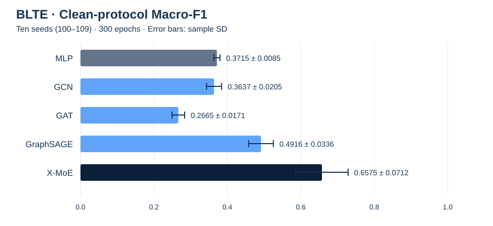
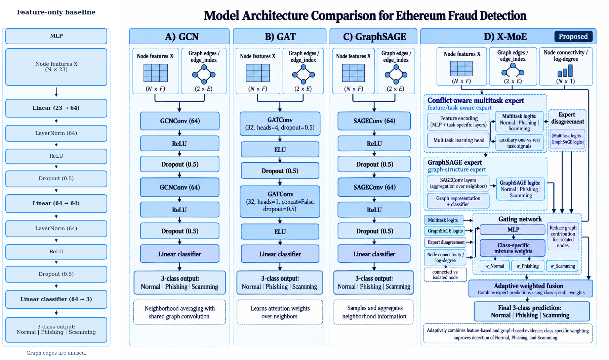
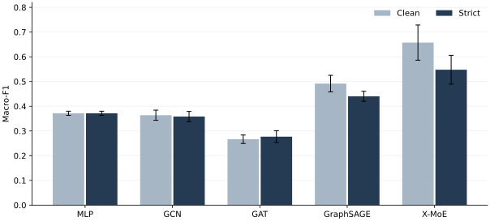

# X-MoE for Ethereum Fraud Detection

This repository provides a reproducible implementation for multi-class Ethereum address fraud detection under severe class imbalance and sparse graph connectivity. It includes conventional graph baselines, a feature-only MLP baseline, the proposed X-MoE framework, manuscript-aligned ablation and sensitivity experiments, strict node-inductive evaluation, reference result summaries, and the interactive Streamlit research demo.


## How to use this guide

This guide reproduces the experiments reported in this repository using processed
BLTE inputs. Commands below use **Windows PowerShell**, run from the repository
root on branch `main`. Copy each block separately and wait for completion.
A backtick must be the final character on a continued PowerShell command line.

1. Clone the repository and create the CPU environment.
2. Install dependencies and verify the BLTE artifact hashes.
3. Run a smoke test to check the pipeline; its scores are not final results.
4. Run all five clean CPU models using ten seeds and 300 epochs.
5. Run the strict, ablation and sensitivity experiments where required.
6. Use a separate GPU environment for CUDA runs.
7. Compare newly generated metrics with frozen evidence; keep new outputs separate.

CPU is sufficient for the reported five-model CPU series. GPU commands require
an NVIDIA CUDA-capable device and a compatible driver. The recorded GPU evidence
covers four models; an MLP GPU command is provided as an additional runnable
experiment, without implying that an MLP GPU reference result exists.

## Models

The main public reproduction runner exposes five models:

- MLP — feature-only baseline
- GCN
- GAT
- GraphSAGE
- X-MoE — proposed task-aware mixture-of-experts framework

The models perform three-class classification:

- Normal
- Phishing
- Scamming

The MLP uses node features only and ignores graph edges. GCN, GAT, and GraphSAGE are graph-learning baselines. X-MoE combines feature/task-aware and graph-structural evidence through adaptive routing.


## Five-model BLTE comparison



Bars show mean Macro-F1 and error bars show sample standard deviation across
seeds 100–109, with 300 epochs per run. The address prediction demo separately
uses the five seed-100 checkpoints. These single-seed predictions are not
substitutes for the ten-seed experimental estimates.

The active MLP ten-seed evidence is in `results/clean/reference/mlp_10seed.csv`.
The MLP seed-100 checkpoint was regenerated and checked against its original
reported metrics, then reloaded and checked against all 10,955 saved test
predictions using the packaged demo inputs. Other datasets are outside this release.

## Dataset Summary

The study uses processed BLTE artifacts released by the upstream project. The repository does not independently reconstruct the raw Ethereum collection or labelling pipeline.

Dataset size:

- 73,033 Ethereum addresses
- 72,865 Normal
- 69 Phishing
- 99 Scamming
- 23 node features
- 6,588 released directed edges
- approximately 92.32% isolated nodes

The severe imbalance and sparse connectivity motivate the use of Macro-F1 as the primary comparison metric and motivate X-MoE's isolate-safe routing design.

### BLTE Input Features

The X-MoE benchmark checkpoint uses the following 23 features in the order shown. The BLTE CSV supplies the raw feature values. Under the `clean` protocol, the runner fits `StandardScaler` on training nodes and applies the fitted transformation to the validation and test nodes.

| Positions | Features in checkpoint order |
|---|---|
| 1–5 | `all_degree`, `in_degree`, `out_degree`, `unique in_degree`, `unique out_degree` |
| 6–9 | `Avg amount incoming`, `Avg amount outgoing`, `Total amount incoming`, `Total amount outgoing` |
| 10–13 | `Max amount incoming`, `Max amount outgoing`, `Min amount incoming`, `Min amount outgoing` |
| 14–18 | `Avg time incoming`, `Avg time outgoing`, `Total transaction time`, `Active Duration`, `Clustering coefficient` |
| 19–23 | `Mean time interval`, `Max time interval`, `Min time interval`, `Avg gas price`, `Avg gas limit` |

The benchmark demo uses the stored BLTE features and graph. Feature equivalence for newly queried Etherscan addresses has yet to be established.

## Architecture Comparison

The figure below compares all five models. MLP uses node attributes only; the remaining models also use graph structure.



All five models solve the same three-class classification problem, but they differ in how node features and graph information are processed.

### A) MLP

The MLP is a feature-only baseline. It receives the same 23 node features but does not perform message passing and does not use graph edges for prediction.

The implemented pipeline is:

```text
Node features (23)
        |
        v
   Linear(64)
        |
    LayerNorm
        |
       ReLU
        |
   Dropout(0.5)
        |
        v
   Linear(64)
        |
    LayerNorm
        |
       ReLU
        |
   Dropout(0.5)
        |
        v
 Linear classifier
        |
        v
Normal | Phishing | Scamming
```

This baseline is important because approximately 92.32% of the addresses are isolated in the released topology. It provides a direct comparison between feature-only learning and graph-based learning.

### B) GCN

The Graph Convolutional Network (GCN) propagates and aggregates information from neighbouring addresses using shared graph convolution.

```text
Node features + graph edges
        |
        v
   GCNConv(64)
        |
       ReLU
        |
   Dropout(0.5)
        |
        v
   GCNConv(64)
        |
       ReLU
        |
   Dropout(0.5)
        |
 Linear classifier
        |
        v
Normal | Phishing | Scamming
```

GCN provides a simple mechanism for incorporating graph structure. However, neighbourhood information is aggregated using the same convolutional mechanism for all nodes. In highly imbalanced fraud detection, minority-class signals can therefore be difficult to preserve when fraudulent addresses are sparse relative to the Normal class.

### C) GAT

The Graph Attention Network (GAT) extends neighbourhood aggregation by learning attention weights over neighbouring nodes.

```text
Node features + graph edges
        |
        v
GATConv(32, heads=4)
        |
       ELU
        |
   Dropout(0.5)
        |
        v
GATConv(32, heads=1)
        |
       ELU
        |
 Linear classifier
        |
        v
Normal | Phishing | Scamming
```

Unlike GCN, GAT does not treat all neighbours equally. It learns which neighbouring addresses should receive greater attention. This provides additional flexibility, but attention alone does not explicitly address severe class imbalance, expert disagreement, or the fact that some Ethereum addresses may have little or no useful neighbourhood structure.

### D) GraphSAGE

GraphSAGE learns node representations by aggregating information from local neighbourhoods.

```text
Node features + graph edges
        |
        v
   SAGEConv(64)
        |
       ReLU
        |
   Dropout(0.5)
        |
        v
   SAGEConv(64)
        |
       ReLU
        |
   Dropout(0.5)
        |
 Linear classifier
        |
        v
Normal | Phishing | Scamming
```

GraphSAGE is the strongest conventional GNN baseline in the verified CPU experiments. Its neighbourhood aggregation is effective for learning relational fraud patterns when meaningful graph connectivity exists. However, it still relies on a single graph-learning mechanism and can be less useful when an address is isolated or when discriminative evidence is primarily contained in node-level features.

### E) X-MoE: Proposed Architecture

X-MoE differs from the conventional baselines by combining complementary evidence pathways through adaptive mixture-of-experts routing.

```text
                         Node features
                              |
                  +-----------+-----------+
                  |                       |
                  v                       v
        Conflict-Aware              GraphSAGE
        Multitask Expert               Expert
                  |                       |
                  v                       v
           Expert 1 logits         Expert 2 logits
                  |                       |
                  +-----------+-----------+
                              |
                    Expert disagreement
                              |
                 Node connectivity / degree
                              |
                              v
                       Gating network
                              |
                              v
                 Class-specific mixture
                         weights
             w_Normal | w_Phishing | w_Scamming
                              |
                              v
                  Adaptive weighted fusion
                              |
                              v
               Normal | Phishing | Scamming
```

#### Expert 1: Conflict-Aware Multitask Expert

The first expert contains a feature branch and an internal GraphSAGE branch. A class-specific inner gate combines these representations using feature evidence, graph evidence, and log degree. This expert is trained with the primary weighted multiclass objective and class-focused auxiliary objectives.

#### Expert 2: GraphSAGE Expert

The second expert is an independently parameterised GraphSAGE model. It captures relational information from neighbouring Ethereum addresses and produces its own three-class prediction.

#### Expert disagreement

X-MoE explicitly incorporates the absolute disagreement between the two expert logits:

```text
| Expert 1 logits - Expert 2 logits |
```

Disagreement is supplied to the outer gate together with the two expert outputs and degree information.

#### Connectivity-aware and isolate-safe routing

A key design feature is that graph-based contribution is explicitly suppressed for isolated nodes. If a node has zero degree, the graph contribution is set to zero so the isolated-node prediction reduces to the feature pathway rather than relying on an uninformative neighbourhood representation.

#### Class-specific mixture weights

X-MoE does not use one global mixture weight. It learns separate routing weights for Normal, Phishing, and Scamming so the relative importance of the experts can vary by class.

Routing weights are interpreted as model diagnostics, not as causal explanations.

### Why the X-MoE Architecture Helps Fraud Detection

The central motivation is that no single source of evidence is equally reliable for every Ethereum address.

For a strongly connected address, graph relationships may contain useful fraud evidence. For an isolated or weakly connected address, node-level features may be more informative than message passing. For difficult minority-class cases, expert disagreement can help the gate decide which evidence source should receive greater weight.

X-MoE therefore combines:

1. feature/task-aware evidence;
2. graph-structural evidence;
3. disagreement between experts; and
4. node connectivity.

This produces an adaptive decision mechanism rather than applying the same graph-learning rule to every address.

## Main Clean-Protocol Results

The verified deterministic CPU experiment uses seeds 100–109 and 300 epochs per seed.

| Model | Accuracy (mean ± std) | Macro-F1 (mean ± std) |
|---|---:|---:|
| GCN | 0.881123 ± 0.032853 | 0.363689 ± 0.020485 |
| GAT | 0.591693 ± 0.033604 | 0.266492 ± 0.017115 |
| MLP | 0.967175 ± 0.008147 | 0.371498 ± 0.008483 |
| GraphSAGE | 0.988188 ± 0.002071 | 0.491619 ± 0.033561 |
| **X-MoE** | **0.996942 ± 0.001153** | **0.657494 ± 0.071187** |

Relative to GraphSAGE, X-MoE improves mean Macro-F1 by:

```text
0.657494 - 0.491619 = 0.165875
```

which is approximately:

```text
+16.59 percentage points
+33.74% relative improvement
```

Accuracy is reported for completeness. Because the dataset is extremely imbalanced, Macro-F1 is the primary comparison metric.

### Class-Specific F1

| Model | Normal F1 | Phishing F1 | Scamming F1 |
|---|---:|---:|---:|
| GCN | 0.9367 | 0.0132 | 0.1412 |
| GAT | 0.7430 | 0.0036 | 0.0528 |
| MLP | 0.9837 | 0.0434 | 0.0874 |
| GraphSAGE | 0.9944 | 0.1023 | 0.3782 |
| **X-MoE** | **0.9988** | **0.5374** | **0.4363** |

The largest class-specific improvement is observed for Phishing.

## Paired Statistical Comparison

The clean baseline analysis uses paired seed-level Macro-F1, two-sided exact Wilcoxon signed-rank tests, Holm correction across the four baseline comparisons, paired effect size d_z, and paired mean-difference confidence intervals. The ablation analysis instead uses an exact paired sign-flip test with Holm correction across seven comparisons; these are separate test families.

| Comparison | Δ Macro-F1 | 95% CI | Holm-adjusted p | d_z | X-MoE wins |
|---|---:|---:|---:|---:|---:|
| X-MoE vs GCN | 0.2938 | [0.2450, 0.3426] | 0.007812 | 4.309 | 10/10 |
| X-MoE vs GAT | 0.3910 | [0.3382, 0.4438] | 0.007812 | 5.299 | 10/10 |
| X-MoE vs MLP | 0.2860 | [0.2387, 0.3333] | 0.007812 | 4.323 | 10/10 |
| X-MoE vs GraphSAGE | 0.1659 | [0.1216, 0.2101] | 0.007812 | 2.681 | 10/10 |

## CPU Reproduction Status

The CPU experiments were reproduced using:

- Python 3.11.9
- pip 24.0
- PyTorch 2.14.1+cpu
- PyTorch Geometric 2.8.0.post1
- NumPy 2.4.6
- Pandas 3.0.6
- scikit-learn 1.9.1
- SciPy 1.17.1
- CPU execution
- clean protocol
- 300 epochs
- seeds 100–109

## Repository Structure

| Path on `main` | Purpose |
|---|---|
| `src/runner.py` | Clean training and evaluation for five models |
| `src/models/` | MLP, GCN, GAT, GraphSAGE and X-MoE implementations |
| `experiments/ablation.py` | Component and connectivity analyses |
| `experiments/strict_inductive.py` | Restricted-topology evaluation |
| `experiments/summarize_results.py` | Frozen-evidence table builder |
| `requirements-cpu.txt`, `requirements-gpu.txt` | Recorded dependency snapshots |
| `ENVIRONMENT_CPU.txt`, `ENVIRONMENT_GPU.txt` | Recorded environment details |
| `results/clean/reference/` | Clean seed-level results for five models |
| `results/strict/reference/` | Strict 50-run aggregate and statistics |
| `results/strict/runs/` | Three evidence files for each model/seed pair |
| `results/ablation/reference/` | Ablation evidence |
| `results/cpu_gpu/` | CPU/GPU comparison summaries |
| `results/sensitivity/` | Sensitivity evidence |
| `results/tables/` | Reporting tables |
| `figures/` | Architecture and performance figures |
| `RESULT_SOURCE_HASHES.json` | Evidence hashes |
| `FILE_RELOCATION_MAP.json` | Historical-to-current path mapping |

The repository uses two branches: `main` for experiment code, results,
supporting tables and figures; and `demo/streamlit` for the application
and inference assets. The paper's LaTeX is maintained separately.
`src/models/__init__.py` exports model classes; run experiments through the runner.

# Step-by-Step CPU Reproduction

## 1. Clone This Repository

```powershell
git clone https://github.com/nurhalizaabdulwahab197/xmoe-ethereum-fraud-detection.git
cd xmoe-ethereum-fraud-detection
```

## 2. Python Environment

The verified CPU environment uses Python 3.11.9.

Check installed Python versions:

```powershell
py -0p
```

Create the virtual environment:

```powershell
py -3.11 -m venv .venv-cpu
```

If PowerShell blocks activation:

```powershell
Set-ExecutionPolicy -Scope Process -ExecutionPolicy Bypass
```

Activate:

```powershell
.\.venv-cpu\Scripts\Activate.ps1
```

Verify:

```powershell
python --version
python -m pip --version
```

Expected:

```text
Python 3.11.9
pip 24.0
```

For strict reproduction of the tested CPU environment, do not upgrade pip before installing the tested requirements.

## 3. Install CPU Dependencies

Pin the recorded installer version inside the activated environment:

```powershell
python -m pip install pip==24.0
```

```powershell
python -m pip install -r .\requirements-cpu.txt
```

Verify the main packages:

```powershell
python -c "import torch, torch_geometric, numpy, pandas, sklearn, scipy; print('torch=' + torch.__version__); print('torch-geometric=' + torch_geometric.__version__); print('numpy=' + numpy.__version__); print('pandas=' + pandas.__version__); print('sklearn=' + sklearn.__version__); print('scipy=' + scipy.__version__); print('cuda=' + str(torch.cuda.is_available()))"
```

Expected tested CPU configuration:

```text
torch=2.14.1+cpu
torch-geometric=2.8.0.post1
numpy=2.4.6
pandas=3.0.6
sklearn=1.9.1
scipy=1.17.1
cuda=False
```

`pip freeze` records the installed package metadata as `torch==2.14.1`, while the PyTorch runtime reports `torch.__version__ == 2.14.1+cpu`. These refer to the same verified CPU environment.

A PyTorch Geometric `torch.jit.script` FutureWarning may appear. It does not prevent the experiments from running.

## 4. Obtain the BLTE Dataset Artifacts

Clone the upstream repository:

```powershell
git clone https://github.com/salam-ammari/Graph-Neural-Network-Based-Fraudulent-Address-Classification-in-Ethereum-Network.git upstream-paper
```

Required artifacts:

```text
upstream-paper/BLTE_multiclass_graph.pt
upstream-paper/BLTE_multiclass_v2.csv
```

Verify SHA-256:

```powershell
Get-FileHash `
  .\upstream-paper\BLTE_multiclass_graph.pt, `
  .\upstream-paper\BLTE_multiclass_v2.csv `
  -Algorithm SHA256
```

Expected hashes:

```text
BLTE_multiclass_graph.pt
2859A8A3A815EDD02B5CD85D46C00D730B2B66C4E8D047145DB2E843C9E38456

BLTE_multiclass_v2.csv
02E376DDD98BA595372F19731FE5E51BBC90BF897B2A52B3C8BB98E786423B11
```

The upstream dataset directory is intentionally excluded from this repository.

## 5. Verify Available Models

```powershell
python .\src\runner.py --help
```

Expected model choices:

```text
{gcn,gat,graphsage,mlp,x_moe_gnn}
```

## 6. Smoke Tests

Smoke tests use seed 100 and 10 epochs. They verify that each training pipeline runs successfully. They are not final performance measurements.

### MLP

```powershell
python .\src\runner.py `
  --model mlp `
  --protocol clean `
  --seeds 100 `
  --epochs 10 `
  --device cpu `
  --upstream .\upstream-paper `
  --output-dir .\results\new_runs\cpu\smoke\mlp `
  --no-save-checkpoints `
  --no-save-predictions
```

### GCN

```powershell
python .\src\runner.py `
  --model gcn `
  --protocol clean `
  --seeds 100 `
  --epochs 10 `
  --device cpu `
  --upstream .\upstream-paper `
  --output-dir .\results\new_runs\cpu\smoke\gcn `
  --no-save-checkpoints `
  --no-save-predictions
```

### GAT

```powershell
python .\src\runner.py `
  --model gat `
  --protocol clean `
  --seeds 100 `
  --epochs 10 `
  --device cpu `
  --upstream .\upstream-paper `
  --output-dir .\results\new_runs\cpu\smoke\gat `
  --no-save-checkpoints `
  --no-save-predictions
```

### GraphSAGE

```powershell
python .\src\runner.py `
  --model graphsage `
  --protocol clean `
  --seeds 100 `
  --epochs 10 `
  --device cpu `
  --upstream .\upstream-paper `
  --output-dir .\results\new_runs\cpu\smoke\graphsage `
  --no-save-checkpoints `
  --no-save-predictions
```

### X-MoE

```powershell
python .\src\runner.py `
  --model x_moe_gnn `
  --protocol clean `
  --seeds 100 `
  --epochs 10 `
  --device cpu `
  --upstream .\upstream-paper `
  --x-moe-normal-phishing-penalty 0.30 `
  --output-dir .\results\new_runs\cpu\smoke\xmoe `
  --no-save-checkpoints `
  --no-save-predictions
```

### Smoke-Test Reference Results

The following deterministic CPU values are implementation checks, not final scientific performance evidence.

| Model | Accuracy | Macro-F1 |
|---|---:|---:|
| GCN | 0.064993 | 0.041525 |
| GAT | 0.528982 | 0.242811 |
| GraphSAGE | 0.001461 | 0.011117 |
| **X-MoE** | **0.926883** | **0.390384** |

The documented historical smoke reference does not include MLP. For MLP, successful execution and output generation are the implementation checks; final MLP performance is reported from the 10-seed experiment below.

## 7. Full 10-Seed CPU Reproduction

All final CPU experiments use:

```text
protocol = clean
seeds = 100,101,102,103,104,105,106,107,108,109
epochs = 300
device = cpu
deterministic = enabled
```

### MLP

```powershell
python .\src\runner.py `
  --model mlp `
  --protocol clean `
  --seeds 100,101,102,103,104,105,106,107,108,109 `
  --epochs 300 `
  --device cpu `
  --deterministic `
  --upstream .\upstream-paper `
  --output-dir .\results\new_runs\cpu\clean\mlp `
  --save-checkpoints `
  --save-predictions
```

Reference summary:

```text
Accuracy = 0.967175 ± 0.008147
Macro-F1 = 0.371498 ± 0.008483
```

### GCN

```powershell
python .\src\runner.py `
  --model gcn `
  --protocol clean `
  --seeds 100,101,102,103,104,105,106,107,108,109 `
  --epochs 300 `
  --device cpu `
  --deterministic `
  --upstream .\upstream-paper `
  --output-dir .\results\new_runs\cpu\clean\gcn `
  --save-checkpoints `
  --save-predictions
```

Reference summary:

```text
Accuracy = 0.881123 ± 0.032853
Macro-F1 = 0.363689 ± 0.020485
```

### GAT

```powershell
python .\src\runner.py `
  --model gat `
  --protocol clean `
  --seeds 100,101,102,103,104,105,106,107,108,109 `
  --epochs 300 `
  --device cpu `
  --deterministic `
  --upstream .\upstream-paper `
  --output-dir .\results\new_runs\cpu\clean\gat `
  --save-checkpoints `
  --save-predictions
```

Reference summary:

```text
Accuracy = 0.591693 ± 0.033604
Macro-F1 = 0.266492 ± 0.017115
```

### GraphSAGE

```powershell
python .\src\runner.py `
  --model graphsage `
  --protocol clean `
  --seeds 100,101,102,103,104,105,106,107,108,109 `
  --epochs 300 `
  --device cpu `
  --deterministic `
  --upstream .\upstream-paper `
  --output-dir .\results\new_runs\cpu\clean\graphsage `
  --save-checkpoints `
  --save-predictions
```

Reference summary:

```text
Accuracy = 0.988188 ± 0.002071
Macro-F1 = 0.491619 ± 0.033561
```

### X-MoE

```powershell
python .\src\runner.py `
  --model x_moe_gnn `
  --protocol clean `
  --seeds 100,101,102,103,104,105,106,107,108,109 `
  --epochs 300 `
  --device cpu `
  --deterministic `
  --upstream .\upstream-paper `
  --x-moe-normal-phishing-penalty 0.30 `
  --output-dir .\results\new_runs\cpu\clean\xmoe `
  --save-checkpoints `
  --save-predictions
```

Reference summary:

```text
Accuracy = 0.996942 ± 0.001153
Macro-F1 = 0.657494 ± 0.071187
```

## 8. Clean Protocol

For every seed, the `clean` protocol:

1. regenerates a stratified 70/15/15 train/validation/test split;
2. fits `StandardScaler` on training nodes only;
3. applies the fitted scaler to validation and test nodes;
4. retains the released BLTE topology across node partitions;
5. trains for 300 epochs;
6. selects the checkpoint with the highest validation Macro-F1; and
7. evaluates once on the held-out test partition.

This main protocol is topology-visible because the released topology is retained. It should not be described as strict node-inductive.

## 9. Interpretation of the CPU Results

The primary comparison is between X-MoE and GraphSAGE, the strongest conventional GNN baseline by mean Macro-F1.

```text
GraphSAGE Macro-F1 = 0.491619
X-MoE Macro-F1     = 0.657494

Absolute improvement = 0.165875
Percentage-point improvement = 16.59
Relative improvement ≈ 33.74%
```

The MLP result provides an additional feature-only control. Its mean Macro-F1 of 0.371498 exceeds GCN in this sparse graph setting but remains substantially below GraphSAGE and X-MoE.

## 10. X-MoE Reference Training Configuration

```text
base_loss = weighted_ce
expert_loss_weight = 0.25
scam_specialist_loss_weight = 0.50
x_moe_expert_task_loss_weight = 1.00
x_moe_normal_phishing_penalty = 0.30
optimizer = Adam
learning_rate = 0.001
weight_decay = 0.0005
hidden_channels = 64
dropout = 0.5
outer_gate_hidden = 32
```

The reference Normal–Phishing coefficient λ_NP = 0.30 is a manuscript reference setting, not a uniquely optimal coefficient.

## 11. Ablation Study: A0–A7

The A0–A7 ablation below uses the main study protocol. The `reproduction` branch reports a separate PCGrad ON/OFF ablation under two reconstructed BLTE configurations. [PCGrad ablation results](https://github.com/nurhalizaabdulwahab197/xmoe-ethereum-fraud-detection/blob/reproduction/README.md#pcgrad-ablation)

Runner:

```text
experiments/ablation.py
```

Check available options:

```powershell
python .\experiments\ablation.py --help
```

Reference results:

| Variant | Mean Macro-F1 | Δ vs A0 |
|---|---:|---:|
| A0 Full X-MoE | 0.6575 | — |
| A1 Conflict-Aware only | 0.6525 | -0.0050 |
| A2 GraphSAGE-expert configuration | 0.6558 | -0.0017 |
| A3 Shared routing | 0.6917 | +0.0342 |
| A4 No isolate masking | 0.7071 | +0.0496 |
| A5 No Scamming specialist | 0.6557 | -0.0018 |
| A6 No Normal–Phishing objective | 0.5526 | -0.1049 |
| A7 Fixed 50:50 outer mixture | 0.6912 | +0.0337 |

A0 is the reference architecture, not the numerically best ablation. A3, A4, and A7 obtain higher mean Macro-F1 than A0. Only A6 shows a family-wise significant overall degradation after Holm correction, indicating that removing the Normal–Phishing objective has the clearest adverse effect in this experiment.

### Run the full eight-variant ablation study

This command requests eight variants across ten seeds: 80 training runs.
Use the explicit 300 epochs below; the script default is a shorter test run.

```powershell
python .\experiments\ablation.py `
  --variant all `
  --protocol clean `
  --seeds 100,101,102,103,104,105,106,107,108,109 `
  --epochs 300 `
  --device cpu `
  --deterministic `
  --upstream .\upstream-paper `
  --expert-loss-weight 0.25 `
  --scam-specialist-loss-weight 0.50 `
  --expert-task-loss-weight 1.00 `
  --normal-phishing-penalty 0.30 `
  --output-dir .\results\new_runs\cpu\ablation
```

To rerun one variant, replace `--variant all` with, for example,
`--variant a6_no_normal_phishing_penalty` and use a new output directory.
For a pipeline test use `--seeds 100 --epochs 2`; do not compare a two-epoch
smoke test with the reported 300-epoch ablation scores.

## 12. Connectivity-Stratified Analysis

The ablation runner also reports connected/isolated subgroup behaviour. No separate connectivity runner is required.

| Metric | Full X-MoE | No isolate masking |
|---|---:|---:|
| Connected-node Macro-F1 | 0.6524 | 0.7273 |
| Connected Phishing F1 | 0.5374 | 0.5576 |
| Connected Scamming F1 | 0.4363 | 0.6301 |
| Isolated Normal FPR | 0.000000 | 0.000307 |

Removing isolate masking improves connected-node discrimination but introduces a small false-positive cost among isolated Normal addresses. All fraud test nodes in this analysis are connected, so the isolated subgroup contains only Normal nodes. The result is therefore interpreted as a performance–safety trade-off rather than simple superiority of either configuration.

## 13. Normal–Phishing Coefficient Sensitivity

The sensitivity experiments can be reproduced with `src/runner.py` by changing:

```text
--x-moe-normal-phishing-penalty
```

while keeping the remaining clean-protocol settings fixed.

| λ_NP | Macro-F1 | Phishing F1 | Scamming F1 |
|---:|---:|---:|---:|
| 0.00 | 0.5526 ± 0.0451 | 0.2379 ± 0.0766 | 0.4226 ± 0.1082 |
| 0.10 | 0.6489 ± 0.0662 | 0.5438 ± 0.1363 | 0.4044 ± 0.1007 |
| **0.30** | 0.6575 ± 0.0712 | 0.5374 ± 0.1433 | **0.4363 ± 0.1010** |
| 0.50 | **0.6580 ± 0.0746** | **0.5551 ± 0.1647** | 0.4203 ± 0.1174 |
| 1.00 | 0.6523 ± 0.0776 | 0.5402 ± 0.1569 | 0.4180 ± 0.1255 |

The main sensitivity occurs when the objective is removed. Positive values from 0.10 to 1.00 form a broad high-performing region. λ_NP = 0.30 is retained as the reference setting and is not claimed as the unique optimum.

Machine-readable summary:

```text
results/sensitivity/lambda/summary.csv
```

### Commands for each sensitivity coefficient

Each block runs X-MoE for ten seeds. Together the five blocks request 50 runs.
All other settings are held fixed. Activate `.venv-cpu` before running them.

#### Coefficient 0.00

```powershell
python .\src\runner.py `
  --model x_moe_gnn `
  --protocol clean `
  --seeds 100,101,102,103,104,105,106,107,108,109 `
  --epochs 300 `
  --device cpu `
  --deterministic `
  --upstream .\upstream-paper `
  --x-moe-normal-phishing-penalty 0.00 `
  --output-dir .\results\new_runs\cpu\sensitivity\lambda_0.00 `
  --save-checkpoints `
  --save-predictions
```

#### Coefficient 0.10

```powershell
python .\src\runner.py `
  --model x_moe_gnn `
  --protocol clean `
  --seeds 100,101,102,103,104,105,106,107,108,109 `
  --epochs 300 `
  --device cpu `
  --deterministic `
  --upstream .\upstream-paper `
  --x-moe-normal-phishing-penalty 0.10 `
  --output-dir .\results\new_runs\cpu\sensitivity\lambda_0.10 `
  --save-checkpoints `
  --save-predictions
```

#### Coefficient 0.30

```powershell
python .\src\runner.py `
  --model x_moe_gnn `
  --protocol clean `
  --seeds 100,101,102,103,104,105,106,107,108,109 `
  --epochs 300 `
  --device cpu `
  --deterministic `
  --upstream .\upstream-paper `
  --x-moe-normal-phishing-penalty 0.30 `
  --output-dir .\results\new_runs\cpu\sensitivity\lambda_0.30 `
  --save-checkpoints `
  --save-predictions
```

#### Coefficient 0.50

```powershell
python .\src\runner.py `
  --model x_moe_gnn `
  --protocol clean `
  --seeds 100,101,102,103,104,105,106,107,108,109 `
  --epochs 300 `
  --device cpu `
  --deterministic `
  --upstream .\upstream-paper `
  --x-moe-normal-phishing-penalty 0.50 `
  --output-dir .\results\new_runs\cpu\sensitivity\lambda_0.50 `
  --save-checkpoints `
  --save-predictions
```

#### Coefficient 1.00

```powershell
python .\src\runner.py `
  --model x_moe_gnn `
  --protocol clean `
  --seeds 100,101,102,103,104,105,106,107,108,109 `
  --epochs 300 `
  --device cpu `
  --deterministic `
  --upstream .\upstream-paper `
  --x-moe-normal-phishing-penalty 1.00 `
  --output-dir .\results\new_runs\cpu\sensitivity\lambda_1.00 `
  --save-checkpoints `
  --save-predictions
```

## 14. STRICT-INDUCTIVE Evaluation

Runner:

```text
experiments/strict_inductive.py
```

Display label:

```text
STRICT-INDUCTIVE
```

Code protocol key:

```text
strict_inductive
```

Check runner options:

```powershell
python .\experiments\strict_inductive.py --help
```

Protocol visibility:

- Training: training features and train–train topology only.
- Validation: train + validation features; train–train, train–validation and validation–train edges; excludes validation–validation edges and all test nodes/edges.
- Test: train + test features; train–train, train–test and test–train edges; excludes test–test edges and all validation nodes/edges.
- The released edge direction is preserved.
- No synthetic reverse edges are added.
- Hard leakage assertions are included in the runner.

Verified Macro-F1:

| Model | STRICT-INDUCTIVE Macro-F1 |
|---|---:|
| MLP | 0.371498 ± 0.008483 |
| GCN | 0.358331 ± 0.020646 |
| GAT | 0.277051 ± 0.023603 |
| GraphSAGE | 0.440139 ± 0.020355 |
| **X-MoE** | **0.547783 ± 0.058151** |

X-MoE exceeds MLP, GCN, GAT and GraphSAGE in all ten matched seeds under this protocol. Each exact paired Wilcoxon comparison has raw p = 0.001953125 and Holm-adjusted p = 0.0078125 across four baselines.

All five models were evaluated using strict seeds 100-109. Its seed-level Macro-F1 equals its clean result for every seed; MLP does not use graph edges. The five-model strict evidence is in `results/strict/reference/strict_50_runs.csv`.



The clean-to-strict family contains five models. Adjusted p-values are MLP 1.000000, GCN 0.644531, GAT 0.058594, GraphSAGE 0.009766 and X-MoE 0.015625. GAT's increase is not significant at 0.05. GraphSAGE and X-MoE decrease significantly.

Run all five strict models from the verified Python environment (this performs training):

```powershell
foreach ($model in @("mlp", "gcn", "gat", "graphsage", "x_moe_gnn")) {
    python .\experiments\strict_inductive.py --model $model --seeds 100,101,102,103,104,105,106,107,108,109 --epochs 300 --device cpu --deterministic --base-loss weighted_ce --no-calibrate-class-bias --x-moe-normal-phishing-penalty 0.30 --save-predictions --upstream .\upstream-paper --output-dir ".\results\strict_fresh\$model"
    if ($LASTEXITCODE -ne 0) { throw "Failed: $model" }
}
```

Use a new output directory for a fresh experiment. Existing verified runs do not need repeating. Check or rebuild the curated tables from the frozen reference CSVs without training:

```powershell
python .\experiments\summarize_five_model_results.py
python .\experiments\summarize_five_model_results.py --apply
```

These commands rebuild tables from archived evidence; they do not automatically promote a new experiment. For the strict minority comparison against GraphSAGE, Holm correction is applied separately across Phishing F1/AP and Scamming F1/AP: adjusted p = 0.0078125, 0.0078125, 0.275390625 and 0.02734375, respectively.

STRICT-INDUCTIVE is a topology-visibility sensitivity analysis. It is not evidence of temporal, cross-chain, or cross-dataset generalisation, and the clean-to-strict change should not be presented as proof of leakage.

### Run all five strict CPU experiments, one model at a time

Activate `.venv-cpu` and run these commands from the `main` repository root.
The script selects the strict protocol internally; it has no `--protocol` flag.
Strict supports saved predictions; its CLI does not expose `--save-checkpoints`.

#### mlp

```powershell
python .\experiments\strict_inductive.py `
  --model mlp `
  --seeds 100,101,102,103,104,105,106,107,108,109 `
  --epochs 300 `
  --device cpu `
  --deterministic `
  --upstream .\upstream-paper `
  --output-dir .\results\new_runs\cpu\strict\mlp `
  --save-predictions
```

#### gcn

```powershell
python .\experiments\strict_inductive.py `
  --model gcn `
  --seeds 100,101,102,103,104,105,106,107,108,109 `
  --epochs 300 `
  --device cpu `
  --deterministic `
  --upstream .\upstream-paper `
  --output-dir .\results\new_runs\cpu\strict\gcn `
  --save-predictions
```

#### gat

```powershell
python .\experiments\strict_inductive.py `
  --model gat `
  --seeds 100,101,102,103,104,105,106,107,108,109 `
  --epochs 300 `
  --device cpu `
  --deterministic `
  --upstream .\upstream-paper `
  --output-dir .\results\new_runs\cpu\strict\gat `
  --save-predictions
```

#### graphsage

```powershell
python .\experiments\strict_inductive.py `
  --model graphsage `
  --seeds 100,101,102,103,104,105,106,107,108,109 `
  --epochs 300 `
  --device cpu `
  --deterministic `
  --upstream .\upstream-paper `
  --output-dir .\results\new_runs\cpu\strict\graphsage `
  --save-predictions
```

#### x_moe_gnn

```powershell
python .\experiments\strict_inductive.py `
  --model x_moe_gnn `
  --seeds 100,101,102,103,104,105,106,107,108,109 `
  --epochs 300 `
  --device cpu `
  --deterministic `
  --upstream .\upstream-paper `
  --x-moe-normal-phishing-penalty 0.30 `
  --output-dir .\results\new_runs\cpu\strict\x_moe_gnn `
  --save-predictions
```

The published strict reference is `results/strict/reference/strict_50_runs.csv`.
New runs are kept separately and do not automatically replace that reference.

## 15. Reproducibility Scope

This repository reproduces experiments using processed BLTE artifacts released by the upstream project. It does not independently reconstruct the complete BLTE dataset from raw blockchain data.

The clean protocol prevents feature-scaling leakage by fitting the scaler on training nodes only, while retaining the released topology. STRICT-INDUCTIVE separately evaluates a stricter node-inductive visibility condition.

Exact bit-for-bit equality across every machine is not guaranteed. Small differences can arise from operating system, CPU/GPU implementation, numerical libraries, thread scheduling, and floating-point behaviour.

## 16. Generated Outputs

When checkpoints and predictions are enabled, the main runner generates per-seed model checkpoints and prediction files. New outputs should be written to a fresh output directory. Published strict metrics, summaries and predictions for all 50 runs are retained under `results/strict/runs/`. Do not overwrite frozen reference evidence with a new run.

Manuscript-facing summaries are stored under:

```text
results/tables/
```

Reference summaries are stored under:

```text
results/clean/reference/
results/strict/reference/
results/ablation/reference/
```

Normal–Phishing sensitivity summary:

```text
results/sensitivity/lambda/summary.csv
```

Important manuscript-facing files include:

```text
results/tables/clean_baseline_10seed.csv
results/tables/minority_class_summary.csv
results/tables/ablation_summary.csv
results/tables/connectivity_analysis.csv
results/tables/efficiency_summary.csv
results/tables/strict_inductive_10seed.csv
results/tables/clean_to_strict_summary.csv
results/tables/statistical_tests.csv
```

## 17. Reproduction Metadata

Exact verified environment details are recorded in:

```text
ENVIRONMENT_CPU.txt
ENVIRONMENT_GPU.txt
requirements-cpu.txt
requirements-gpu.txt
```

## 18. Live Research Demo

A public X-MoE research demo is available on Streamlit Community Cloud:

**[Open the X-MoE Ethereum Fraud Detection Demo](https://xmoe-ethereum-fraud-detection.streamlit.app/)**

The repository now contains the latest demo source together with the manuscript-aligned research code. The remote repository keeps two long-lived branches:

```text
main   # complete current research source of truth
demo/streamlit   # deployment/demo branch
```

The demo provides:

- an overview of the multi-class Ethereum fraud detection problem;
- architecture comparisons;
- X-MoE architecture exploration;
- verified model metrics;
- class-wise performance;
- graph exploration;
- model explanation diagnostics;
- reference prediction/checkpoint assets; and
- research communication material.

Relevant source locations include:

```text
demo/
interactive_demo/
.streamlit/
```

The demo is intended for research communication, reproducibility, and model exploration. Quantitative manuscript claims are based on controlled multi-seed experiments, not on individual demo predictions. The demo is not a production service for certifying whether an arbitrary Ethereum address is safe or fraudulent.

# GPU Reproduction Results

GPU reproduction was independently performed using the same clean protocol, seeds 100–109, and 300 epochs.

Verified historical GPU environment:

```text
GPU: NVIDIA GeForce GTX 1660 SUPER
VRAM: 6 GB
NVIDIA Driver: 595.95
PyTorch: 2.14.1+cu126
CUDA runtime: 12.6
PyTorch Geometric: 2.8.0.post1
Python: 3.11.9
```

## Install the Verified GPU Environment

Before installing GPU dependencies, open a new PowerShell terminal in the
repository root. Use a separate environment so CPU and CUDA packages do not mix.

### 1. Check NVIDIA driver and installed Python

```powershell
nvidia-smi
py -0p
```

The recorded environment uses Python 3.11.9. `py -3.11` selects an installed
3.11 interpreter; check the patch version before comparing environments.
`nvidia-smi` reports driver capability; `torch.version.cuda` below reports the
runtime used by the installed PyTorch build.

### 2. Create and activate the GPU environment

```powershell
py -3.11 -m venv .venv-gpu
```

If PowerShell blocks activation, allow it for this terminal session:

```powershell
Set-ExecutionPolicy -Scope Process -ExecutionPolicy Bypass
```

```powershell
.\.venv-gpu\Scripts\Activate.ps1
python --version
python -m pip --version
python -m pip install pip==24.0
```

### 3. Install the recorded CUDA dependency snapshot

```powershell
python -m pip install -r .\requirements-gpu.txt --extra-index-url https://download.pytorch.org/whl/cu126
```

Verify:

```powershell
python -c "import torch; print('torch=', torch.__version__); print('cuda runtime=', torch.version.cuda); print('cuda available=', torch.cuda.is_available())"
```

Expected tested configuration:

```text
torch=2.14.1+cu126
cuda runtime=12.6
cuda available=True
```

## Reproduce the Historical GPU Experiments

The historical GPU reference predates the manuscript-aligned MLP comparison and therefore contains GCN, GAT, GraphSAGE, and X-MoE only.

### GCN

```powershell
python .\src\runner.py `
  --model gcn `
  --protocol clean `
  --seeds 100,101,102,103,104,105,106,107,108,109 `
  --epochs 300 `
  --device cuda `
  --deterministic `
  --upstream .\upstream-paper `
  --output-dir .\results\new_runs\gpu\clean\gcn `
  --save-checkpoints `
  --save-predictions
```

### GAT

```powershell
python .\src\runner.py `
  --model gat `
  --protocol clean `
  --seeds 100,101,102,103,104,105,106,107,108,109 `
  --epochs 300 `
  --device cuda `
  --deterministic `
  --upstream .\upstream-paper `
  --output-dir .\results\new_runs\gpu\clean\gat `
  --save-checkpoints `
  --save-predictions
```

### GraphSAGE

```powershell
python .\src\runner.py `
  --model graphsage `
  --protocol clean `
  --seeds 100,101,102,103,104,105,106,107,108,109 `
  --epochs 300 `
  --device cuda `
  --deterministic `
  --upstream .\upstream-paper `
  --output-dir .\results\new_runs\gpu\clean\graphsage `
  --save-checkpoints `
  --save-predictions
```

### X-MoE

```powershell
python .\src\runner.py `
  --model x_moe_gnn `
  --protocol clean `
  --seeds 100,101,102,103,104,105,106,107,108,109 `
  --epochs 300 `
  --device cuda `
  --deterministic `
  --upstream .\upstream-paper `
  --x-moe-normal-phishing-penalty 0.30 `
  --output-dir .\results\new_runs\gpu\clean\xmoe `
  --save-checkpoints `
  --save-predictions
```

### MLP: additional GPU experiment

This command uses the same clean settings. There is no frozen MLP GPU result
in the historical four-model comparison; assess this new output separately.

```powershell
python .\src\runner.py `
  --model mlp `
  --protocol clean `
  --seeds 100,101,102,103,104,105,106,107,108,109 `
  --epochs 300 `
  --device cuda `
  --deterministic `
  --upstream .\upstream-paper `
  --output-dir .\results\new_runs\gpu\clean\mlp `
  --save-checkpoints `
  --save-predictions
```
## CPU vs GPU Macro-F1

| Model | CPU Macro-F1 | GPU Macro-F1 |
|---|---:|---:|
| GCN | 0.363689 ± 0.020485 | 0.363670 ± 0.017636 |
| GAT | 0.266492 ± 0.017115 | 0.275000 ± 0.029484 |
| GraphSAGE | 0.491619 ± 0.033561 | 0.495760 ± 0.031397 |
| **X-MoE** | **0.657494 ± 0.071187** | **0.657782 ± 0.065579** |

The historical model ranking is preserved across CPU and GPU environments:

```text
X-MoE > GraphSAGE > GCN > GAT
```

On the tested GPU environment, X-MoE improves mean Macro-F1 over GraphSAGE from 0.495760 to 0.657782, corresponding to an absolute improvement of 0.162022 (+16.20 percentage points), or approximately +32.68% relative improvement.

The CPU and GPU results are closely consistent but are not expected to be bitwise identical. Minor numerical variation can arise from differences between CPU and CUDA execution paths.

## Checking generated results

The clean runner writes a seed-level metrics CSV and a `_summary.csv` containing
mean and sample standard deviation across the requested seeds. With saving
flags enabled, it also writes per-seed checkpoints and test predictions.
A checkpoint is validation-selected; do not select runs by test performance.

For example, after the GCN CPU run:

```powershell
Get-ChildItem .\results\new_runs\cpu\clean\gcn
Get-ChildItem .\results\new_runs\cpu\clean\gcn\*_summary.csv |
    ForEach-Object { Get-Content -LiteralPath $_.FullName }
```

Check all requested seeds are present before comparing means. Compare the same
model, protocol, seeds, epochs, dataset hashes and device. CPU/GPU differences
should be reported separately; exact cross-device equality is not expected.
Use the tables above as reference values, not as hard-coded outputs to recreate.

### Check frozen reference tables without retraining

```powershell
python .\experiments\summarize_results.py --help
python .\experiments\summarize_results.py
```

The summarizer reads frozen reference inputs. It does **not** automatically ingest
your `results/new_runs/` directory. Its default mode checks/prints reporting tables.
To intentionally regenerate this branch's reporting tables from the frozen inputs:

```powershell
python .\experiments\summarize_results.py --apply
```

Review any changed table before publishing. Updating `main` does not update sibling
branches automatically.

### Verify the published raw strict inventory

```powershell
Get-ChildItem .\results\strict\runs -Recurse -File |
    Group-Object Extension | Select-Object Name, Count
```

The published series contains 150 CSV files: five models, ten seeds (100-109),
and metrics, summary and prediction files for each model/seed pair. GCN seed 108
is one of these primary runs; it is not an extra experimental condition.

## Run the demo from its dedicated branch

Create a separate clone so switching branches cannot disturb experiment outputs:

```powershell
cd ..
git clone --branch demo/streamlit --single-branch https://github.com/nurhalizaabdulwahab197/xmoe-ethereum-fraud-detection.git xmoe-demo
cd xmoe-demo
py -3.11 -m venv .venv-demo
.\.venv-demo\Scripts\Activate.ps1
python -m pip install -r .\demo\requirements.txt
python -m streamlit run .\demo\streamlit_app.py --server.port 8502
```

If another virtual environment is active, open a new terminal first. If activation
is blocked, use the process-scoped execution-policy command given above.
Open `http://localhost:8502`. Inference uses clean seed-100 checkpoints for all
five models. Protocol Comparison displays ten-seed aggregates. Predictions from
one demo checkpoint are not the multi-seed experimental estimates.

## Troubleshooting

| Symptom | Action |
|---|---|
| `python` uses an unexpected environment | Run `Get-Command python` and `python --version`; activate the intended environment |
| Activation is blocked | Use the process-scoped execution-policy command above |
| CUDA is unavailable | Check `nvidia-smi`, GPU environment activation, PyTorch build and `torch.version.cuda`; use `--device cpu` for CPU experiments |
| Dependency installation fails | Retain the error log and compare Python and pip versions with the recorded snapshot; do not silently change research dependencies |
| BLTE file is missing | Check both required files exist directly under the folder passed to `--upstream` |
| Dataset hash differs | Identify the input version before comparing against the published reference |
| A command rejects an argument | Use that specific script's `--help`; clean, strict and ablation options differ |
| Two-epoch scores differ from the paper tables | Smoke tests validate execution, not final model performance |
| `torch.jit.script` FutureWarning appears | Record the warning; it alone does not mean the run failed |
| Existing output files would be reused | Choose a fresh `--output-dir` to preserve previous results |

Stop a foreground process with **Ctrl+C**. Keep its output directory if interrupted;
do not treat partial seed coverage as a complete ten-seed experiment.

## License and Dataset Attribution

The source code in this repository is released under the MIT License.

The BLTE dataset is **not redistributed** in this repository. The processed dataset artifacts used for reproduction must be obtained from the original upstream project:

```text
salam-ammari/Graph-Neural-Network-Based-Fraudulent-Address-Classification-in-Ethereum-Network
```

The dataset and any external data used by the upstream project remain subject to the licenses, attribution requirements, terms of use, and ethical restrictions specified by their original providers.

This repository claims authorship only for the code and methodology developed here, including the proposed X-MoE implementation, experimental validation, reproducibility workflow, and research demo, and does not claim ownership of the upstream BLTE dataset.
